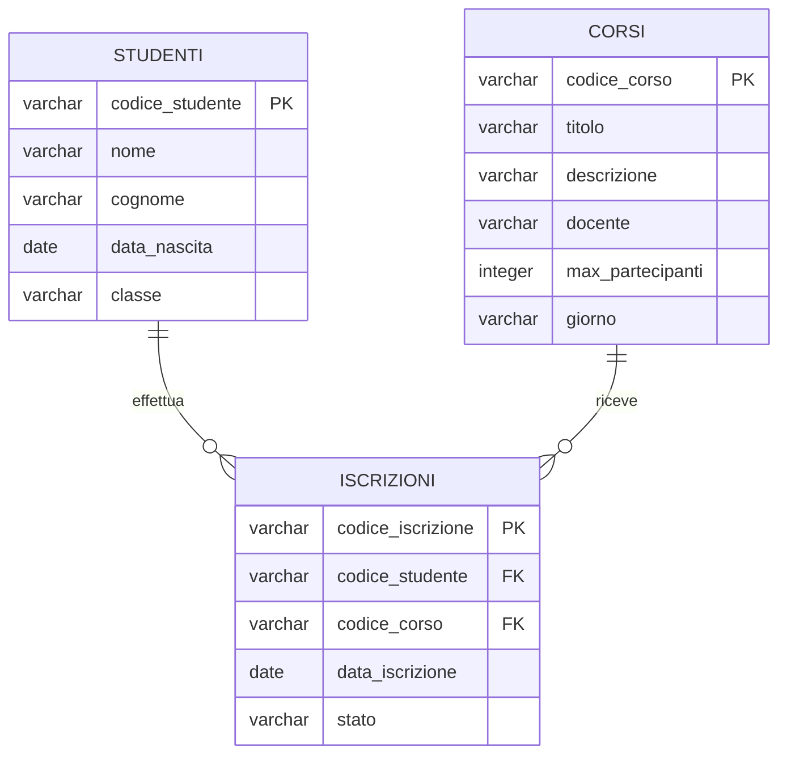

# SQL e basi di dati relazionali — Dispensa approfondita

**Informatica — classe quarta | Laboratorio con DB Browser for SQLite**  
**Caso di studio:** gestione dei corsi pomeridiani  
**Percorso:** DDL → DML → QL

> **Guida all'uso.** Questa dispensa raccoglie le quattro sezioni didattiche approvate. I blocchi `sql` sono copiabili in **Esegui SQL** di DB Browser for SQLite. Creare un database vuoto e rispettare l'ordine delle operazioni. Gli esempi di `UPDATE` e `DELETE` includono i ripristini per mantenere i dati coerenti con le query successive. Tutti i dati sono fittizi.

---

# SEZIONE 1 — Introduzione al linguaggio SQL e presentazione del database

**Obiettivo della sezione:** comprendere a cosa serve SQL, conoscere le sue principali categorie di istruzioni e osservare un esempio concreto di database relazionale, prima di passare alla sua implementazione.

## 1.1 Il linguaggio SQL

SQL (*Structured Query Language*) è un linguaggio utilizzato per interagire con le basi di dati relazionali attraverso un sistema di gestione denominato **DBMS** (*Database Management System*).

Attraverso SQL possiamo definire la struttura di un database, inserire e modificare i dati memorizzati ed effettuare interrogazioni per ricavare le informazioni di nostro interesse.

Le istruzioni SQL vengono comunemente suddivise, a livello didattico, in diverse categorie, ciascuna destinata a uno specifico insieme di operazioni.

### DDL — Data Definition Language

Il DDL, ovvero *linguaggio di definizione dei dati*, comprende le istruzioni che permettono di **definire e modificare la struttura di un database** e degli oggetti che lo compongono.

| Istruzione | Funzione |
|---|---|
| `CREATE` | Crea un nuovo oggetto, ad esempio una tabella |
| `ALTER` | Modifica la struttura di una tabella esistente |
| `DROP` | Elimina un oggetto dal database |

Attraverso il DDL possiamo definire le tabelle, specificare gli attributi, assegnare i tipi di dato e stabilire i vincoli di integrità, come chiavi primarie ed esterne.

**Esempio:** creare una tabella per memorizzare gli studenti di una scuola.

### DML — Data Manipulation Language

Il DML, ovvero *linguaggio di manipolazione dei dati*, comprende le istruzioni utilizzate per **inserire, modificare ed eliminare i dati contenuti nelle tabelle**.

| Istruzione | Funzione |
|---|---|
| `INSERT INTO` | Inserisce una o più tuple in una tabella |
| `UPDATE` | Modifica i valori delle tuple esistenti |
| `DELETE FROM` | Elimina una o più tuple da una tabella |

Le istruzioni DML agiscono sui dati memorizzati, senza modificare la struttura delle tabelle.

**Esempio:** inserire un nuovo studente, modificarne la classe oppure eliminare la sua registrazione.

### QL — Query Language

Il QL, ovvero *linguaggio di interrogazione*, comprende le istruzioni utilizzate per **consultare ed estrarre informazioni dai dati memorizzati nel database**.

| Istruzione | Funzione |
|---|---|
| `SELECT` | Seleziona ed estrae dati da una o più tabelle |

Attraverso le interrogazioni, denominate *query*, possiamo selezionare specifiche colonne, filtrare le tuple in base a determinate condizioni, ordinare i risultati e combinare dati provenienti da più tabelle.

**Esempio:** individuare tutti gli studenti iscritti a un determinato corso pomeridiano.

> **Nota terminologica.** La categoria delle interrogazioni viene spesso indicata anche come **DQL** (*Data Query Language*). In alcune classificazioni, `SELECT` è considerata parte del DML. Qui manteniamo distinti DML e QL per evidenziare la differenza fra manipolazione e interrogazione dei dati.

### Riepilogo

| Categoria | Significato | Ambito |
|---|---|---|
| **DDL** | Definizione | Struttura del database |
| **DML** | Manipolazione | Dati memorizzati |
| **QL** | Interrogazione | Informazioni ricavate dai dati |

## 1.2 Il caso di studio: la gestione dei corsi pomeridiani

Un istituto scolastico organizza periodicamente corsi pomeridiani ai quali gli studenti possono iscriversi volontariamente.

La scuola desidera realizzare un database per gestire le informazioni relative agli studenti, ai corsi disponibili e alle iscrizioni effettuate.

In particolare, il sistema deve consentire di:

- Memorizzare i dati anagrafici degli studenti e la classe frequentata.
- Registrare i corsi disponibili, le relative caratteristiche e il docente responsabile.
- Associare ciascuno studente ai corsi ai quali si è iscritto.
- Registrare la data e lo stato di ogni iscrizione.
- Consultare le informazioni per individuare, ad esempio, gli iscritti a un corso oppure i corsi frequentati da un determinato studente.

### Individuazione delle entità

Dall'analisi del problema individuiamo tre entità principali:

- **STUDENTI:** rappresenta gli studenti dell'istituto.
- **CORSI:** rappresenta le attività pomeridiane organizzate dalla scuola.
- **ISCRIZIONI:** rappresenta le singole iscrizioni degli studenti ai corsi.

La terza entità è necessaria per rappresentare correttamente il collegamento tra studenti e corsi.

## 1.3 Il modello logico relazionale

Ogni entità viene rappresentata attraverso una tabella, costituita da attributi (colonne) e tuple (righe).

### Schema delle tabelle

**STUDENTI** — 5 attributi

| Attributo | Ruolo |
|---|---|
| `codice_studente` | **PK** |
| `nome` | — |
| `cognome` | — |
| `data_nascita` | — |
| `classe` | — |

**CORSI** — 6 attributi

| Attributo | Ruolo |
|---|---|
| `codice_corso` | **PK** |
| `titolo` | — |
| `descrizione` | — |
| `docente` | — |
| `max_partecipanti` | — |
| `giorno` | — |

**ISCRIZIONI** — 5 attributi

| Attributo | Ruolo |
|---|---|
| `codice_iscrizione` | **PK** |
| `codice_studente` | **FK → STUDENTI** |
| `codice_corso` | **FK → CORSI** |
| `data_iscrizione` | — |
| `stato` | — |

**Legenda:** **PK** (*Primary Key*) indica la chiave primaria, che identifica univocamente ogni tupla. **FK** (*Foreign Key*) indica una chiave esterna, utilizzata per collegare una tabella a un'altra.

### Le relazioni e le molteplicità



**Relazione STUDENTI–ISCRIZIONI (1:N).** Uno studente può effettuare zero, una o più iscrizioni. Ogni iscrizione deve appartenere a uno e un solo studente.

**Relazione CORSI–ISCRIZIONI (1:N).** Un corso può avere zero, una o più iscrizioni. Ogni iscrizione deve riferirsi a uno e un solo corso.

**Relazione STUDENTI–CORSI (N:M).** Uno studente può iscriversi a più corsi e ciascun corso può essere frequentato da più studenti. Questa relazione molti-a-molti viene realizzata mediante la tabella associativa ISCRIZIONI, che contiene le chiavi esterne delle altre due tabelle.

## 1.4 Esempi di tuple delle tabelle

Prima di creare fisicamente il database attraverso SQL, osserviamo come potrebbero essere popolate le tre tabelle. Gli esempi utilizzano dati fittizi, che verranno successivamente inseriti mediante le istruzioni `INSERT INTO`.

### Tabella STUDENTI — 8 tuple

| codice_studente (PK) | nome | cognome | data_nascita | classe |
|---|---|---|---|---|
| S001 | Giulia | Rossi | 2009-03-14 | 4AS |
| S002 | Marco | Bianchi | 2008-11-02 | 4AS |
| S003 | Sofia | Verdi | 2009-06-21 | 4AS |
| S004 | Luca | Neri | 2009-01-09 | 4BS |
| S005 | Emma | Gallo | 2008-09-30 | 4BS |
| S006 | Andrea | Conti | 2009-12-17 | 4AS |
| S007 | Chiara | Moretti | 2008-04-05 | 4BS |
| S008 | Davide | Romano | 2009-08-12 | 4AS |

Ogni riga rappresenta uno studente. Ad esempio, la prima tupla contiene i dati di Giulia Rossi, identificata univocamente dal codice `S001`.

### Tabella CORSI — 5 tuple

| codice_corso (PK) | titolo | descrizione | docente | max_partecipanti | giorno |
|---|---|---|---|---:|---|
| C01 | Python base | Introduzione alla programmazione | Prof. Ferri | 4 | Lunedì |
| C02 | Fotografia digitale | Scatto e composizione | Prof.ssa Greco | 3 | Martedì |
| C03 | Inglese conversazione | Dialoghi in lingua inglese | Prof.ssa Riva | 4 | Mercoledì |
| C04 | Robotica educativa | Sensori e piccoli robot | Prof. Moretti | 3 | Giovedì |
| C05 | Teatro | Espressione e recitazione | Prof.ssa Costa | 2 | Venerdì |

Ogni riga rappresenta un corso. Ad esempio, il corso `C01` si chiama Python base, è tenuto dal professor Ferri e prevede un massimo di quattro partecipanti.

### Tabella ISCRIZIONI — 12 tuple

| codice_iscrizione (PK) | codice_studente (FK) | codice_corso (FK) | data_iscrizione | stato |
|---|---|---|---|---|
| I001 | S001 | C01 | 2026-10-05 | attiva |
| I002 | S001 | C02 | 2026-10-06 | attiva |
| I003 | S002 | C01 | 2026-10-05 | attiva |
| I004 | S002 | C03 | 2026-10-07 | completata |
| I005 | S003 | C03 | 2026-10-06 | attiva |
| I006 | S004 | C04 | 2026-10-08 | attiva |
| I007 | S004 | C01 | 2026-10-09 | ritirata |
| I008 | S005 | C02 | 2026-10-06 | attiva |
| I009 | S005 | C03 | 2026-10-07 | attiva |
| I010 | S006 | C01 | 2026-10-09 | attiva |
| I011 | S006 | C04 | 2026-10-10 | attiva |
| I012 | S007 | C03 | 2026-10-10 | attiva |

Questa tabella contiene le informazioni che permettono di collegare gli studenti ai rispettivi corsi. Ad esempio, la tupla `I001` indica che lo studente `S001` (Giulia Rossi) si è iscritto al corso `C01` (Python base) il 5 ottobre 2026 e che l'iscrizione è attiva.

**Perché non memorizziamo direttamente il nome dello studente e il titolo del corso?** Perché queste informazioni sono già presenti nelle rispettive tabelle. Utilizzando le chiavi esterne, evitiamo di duplicare inutilmente i dati e possiamo recuperarli attraverso apposite interrogazioni SQL.

## 1.5 Comprendere le relazioni attraverso i dati

### Esempio 1 — Uno studente iscritto a più corsi

Giulia Rossi (`S001`) è collegata a due diverse iscrizioni:

| Studente | Iscrizione | Corso |
|---|---|---|
| S001 — Giulia Rossi | I001 | C01 — Python base |
| S001 — Giulia Rossi | I002 | C02 — Fotografia digitale |

Uno stesso studente può essere collegato a più tuple della tabella ISCRIZIONI.

### Esempio 2 — Un corso con più studenti

Il corso `C01` — Python base presenta quattro iscrizioni registrate:

| Studente | Iscrizione | Stato |
|---|---|---|
| S001 — Giulia Rossi | I001 | attiva |
| S002 — Marco Bianchi | I003 | attiva |
| S004 — Luca Neri | I007 | ritirata |
| S006 — Andrea Conti | I010 | attiva |

Quattro iscrizioni registrate, di cui tre attive e una ritirata. Questi esempi mostrano perché è necessario utilizzare ISCRIZIONI per rappresentare la relazione N:M tra STUDENTI e CORSI.

## 1.6 Osservazioni e domande per la classe

1. **Quali corsi ha scelto Giulia Rossi?** Giulia Rossi (`S001`) ha due iscrizioni: Python base (`C01`) e Fotografia digitale (`C02`).
2. **Quali studenti hanno un'iscrizione attiva a Python base?** Giulia Rossi (`S001`), Marco Bianchi (`S002`) e Andrea Conti (`S006`). Luca Neri compare tra gli iscritti, ma la sua iscrizione è ritirata.
3. **Quale studente non risulta iscritto ad alcun corso?** Davide Romano (`S008`), perché il suo codice non compare nella tabella ISCRIZIONI.
4. **Quale corso non presenta ancora iscrizioni?** Teatro (`C05`), perché il codice `C05` non compare nelle tuple di ISCRIZIONI.
5. **Perché la tabella ISCRIZIONI contiene due chiavi esterne?** Perché deve collegare ciascuna iscrizione a uno studente esistente e a un corso esistente, consentendo di realizzare la relazione N:M.

### Conclusione della prima sezione

Abbiamo introdotto le principali categorie di istruzioni SQL e analizzato un caso di studio, rappresentandolo mediante tre tabelle collegate attraverso chiavi primarie ed esterne. Nella sezione successiva affronteremo il DDL, traducendo il modello relazionale nelle istruzioni `CREATE TABLE` necessarie a creare concretamente il database in SQLite.

---

# SEZIONE 2 — DDL: definizione e creazione delle tabelle

**Obiettivo della sezione:** comprendere come tradurre un modello logico relazionale in istruzioni SQL, creando le tabelle, definendo i tipi di dato e applicando i principali vincoli di integrità.

## 2.1 Dal modello logico al database

Nella sezione precedente abbiamo individuato tre tabelle per la gestione dei corsi pomeridiani: **STUDENTI**, **CORSI** e **ISCRIZIONI**. Il modello logico relazionale descrive la struttura del database, ma per creare concretamente le tabelle dobbiamo utilizzare SQL.

In particolare utilizzeremo il **DDL (Data Definition Language)**, che permette di definire e modificare la struttura degli oggetti presenti in un database.

| Istruzione | Funzione |
|---|---|
| `CREATE TABLE` | Crea una nuova tabella |
| `ALTER TABLE` | Modifica la struttura di una tabella esistente |
| `DROP TABLE` | Elimina una tabella dal database |

## 2.2 L'istruzione CREATE TABLE

La sintassi generale per creare una tabella è:

```sql
CREATE TABLE Nome_Tabella (
    Attributo1 TIPO_DATO VINCOLI,
    Attributo2 TIPO_DATO VINCOLI,
    Attributo3 TIPO_DATO VINCOLI
);
```

Ogni attributo deve avere un nome e un tipo di dato. Possiamo inoltre specificare uno o più vincoli di integrità. Le definizioni degli attributi sono separate da virgole, mentre il punto e virgola conclude l'istruzione SQL.

## 2.3 I principali tipi di dato

Quando definiamo un attributo dobbiamo specificare quali valori intendiamo memorizzare al suo interno.

### Tipi testuali

| Tipo | Descrizione | Esempio |
|---|---|---|
| `CHAR(n)` | Stringa di lunghezza fissa secondo la semantica SQL tradizionale | `CHAR(4)` |
| `VARCHAR(n)` | Stringa di lunghezza variabile, con massimo previsto di n caratteri | `VARCHAR(50)` |

```sql
codice_studente CHAR(4)
nome VARCHAR(50)
```

Il codice identificativo di uno studente segue una struttura di quattro caratteri, come `S001`, mentre il nome può avere lunghezza variabile. **In SQLite, `CHAR(4)` non obbliga ad avere quattro caratteri e `VARCHAR(50)` non impedisce di superare i 50 caratteri.** Per imporre queste condizioni useremo `CHECK`.

### Tipi numerici

| Tipo | Descrizione | Esempio |
|---|---|---|
| `INTEGER` | Numero intero | `INTEGER` |
| `NUMERIC(p)` | Valore numerico con precisione dichiarata p | `NUMERIC(4)` |
| `NUMERIC(p,s)` | Valore numerico con precisione p e scala s | `NUMERIC(6,2)` |

Nella terminologia SQL tradizionale, `NUMERIC(4)` indica una precisione di quattro cifre, mentre `NUMERIC(6,2)` indica sei cifre complessive, delle quali due dopo la virgola decimale. In SQLite queste indicazioni di precisione non costituiscono limiti effettivi.

Per imporre un intervallo:

```sql
max_partecipanti NUMERIC(4) NOT NULL
    CHECK (max_partecipanti BETWEEN 1 AND 30)
```

L'operatore `BETWEEN` comprende entrambi gli estremi dell'intervallo.

### Tipi temporali

| Tipo | Descrizione | Esempio |
|---|---|---|
| `DATE` | Data | `'2009-03-14'` |
| `TIME` | Ora | `'15:30:00'` |
| `TIMESTAMP` | Data e ora | `'2026-10-05 15:30:00'` |

I formati che adotteremo sono `YYYY-MM-DD` per la data, `HH:MM:SS` per l'ora e `YYYY-MM-DD HH:MM:SS` per data e ora.

In SQLite `DATE`, `TIME` e `TIMESTAMP` possono essere utilizzati nelle dichiarazioni delle colonne, ma non corrispondono a veri tipi di memorizzazione temporale dedicati. Useremo rappresentazioni testuali compatibili con le funzioni di SQLite.

## 2.4 I principali vincoli di integrità

I vincoli di integrità definiscono le regole che i dati devono rispettare.

| Vincolo | Funzione |
|---|---|
| `PRIMARY KEY` | Identifica univocamente ogni tupla |
| `NOT NULL` | Impedisce valori nulli |
| `UNIQUE` | Impone l'unicità dei valori o di una combinazione di valori |
| `CHECK` | Verifica una condizione sui dati |
| `FOREIGN KEY` | Definisce un collegamento con una tabella di riferimento |
| `REFERENCES` | Specifica la tabella e gli attributi referenziati |

### PRIMARY KEY e NOT NULL

```sql
codice_studente CHAR(4) PRIMARY KEY NOT NULL
```

L'attributo `codice_studente` costituisce la chiave primaria e il suo valore deve essere unico. `NOT NULL` impedisce che venga lasciato nullo; lo specifichiamo esplicitamente per evitare una particolarità delle tabelle ordinarie SQLite, nelle quali una chiave primaria non intera può in alcuni casi accettare `NULL`.

### CHECK

Il vincolo `CHECK` permette di imporre ulteriori condizioni:

```sql
-- Lunghezza del codice
CHECK (LENGTH(codice_studente) = 4)

-- Stringa non vuota
CHECK (TRIM(nome) <> '')

-- Intervallo numerico
CHECK (max_partecipanti BETWEEN 1 AND 30)

-- Valori ammessi
CHECK (stato IN ('attiva', 'ritirata', 'completata'))
```

`LENGTH()` restituisce il numero dei caratteri, `TRIM()` elimina gli spazi iniziali e finali, `<>` significa *diverso da*, `BETWEEN` impone un intervallo e `IN` controlla l'appartenenza a un insieme di valori.

## 2.5 Creazione della tabella STUDENTI

La prima tabella da creare contiene le informazioni anagrafiche degli studenti.

```sql
CREATE TABLE STUDENTI (
    codice_studente CHAR(4) PRIMARY KEY NOT NULL
        CHECK (
            LENGTH(codice_studente) = 4
            AND TRIM(codice_studente) <> ''
        ),

    nome VARCHAR(50) NOT NULL
        CHECK (
            LENGTH(TRIM(nome)) > 0
            AND LENGTH(nome) <= 50
        ),

    cognome VARCHAR(50) NOT NULL
        CHECK (
            LENGTH(TRIM(cognome)) > 0
            AND LENGTH(cognome) <= 50
        ),

    data_nascita DATE NOT NULL,

    classe VARCHAR(5) NOT NULL
        CHECK (
            LENGTH(TRIM(classe)) > 0
            AND LENGTH(classe) <= 5
        )
);
```

| Attributo | Tipo di dato | Vincoli principali |
|---|---|---|
| `codice_studente` | `CHAR(4)` | PK, non nullo, lunghezza 4 |
| `nome` | `VARCHAR(50)` | Non nullo, non vuoto, max 50 |
| `cognome` | `VARCHAR(50)` | Non nullo, non vuoto, max 50 |
| `data_nascita` | `DATE` | Non nullo |
| `classe` | `VARCHAR(5)` | Non nullo, non vuoto, max 5 |

La chiave primaria è `codice_studente`. I controlli `CHECK` verificano alcune regole relative ai domini. Per `data_nascita` adotteremo `YYYY-MM-DD`, ma `NOT NULL` ne richiede soltanto la presenza e non ne verifica la correttezza.

## 2.6 Creazione della tabella CORSI

```sql
CREATE TABLE CORSI (
    codice_corso CHAR(3) PRIMARY KEY NOT NULL
        CHECK (
            LENGTH(codice_corso) = 3
            AND TRIM(codice_corso) <> ''
        ),

    titolo VARCHAR(80) NOT NULL
        CHECK (
            LENGTH(TRIM(titolo)) > 0
            AND LENGTH(titolo) <= 80
        ),

    descrizione VARCHAR(200)
        CHECK (LENGTH(descrizione) <= 200),

    docente VARCHAR(60) NOT NULL
        CHECK (
            LENGTH(TRIM(docente)) > 0
            AND LENGTH(docente) <= 60
        ),

    max_partecipanti NUMERIC(4) NOT NULL
        CHECK (
            TYPEOF(max_partecipanti) = 'integer'
            AND max_partecipanti BETWEEN 1 AND 30
        ),

    giorno VARCHAR(12) NOT NULL
        CHECK (
            giorno IN (
                'Lunedì', 'Martedì', 'Mercoledì',
                'Giovedì', 'Venerdì'
            )
        )
);
```

| Attributo | Tipo | Vincoli principali |
|---|---|---|
| `codice_corso` | `CHAR(3)` | PK, non nullo, lunghezza 3 |
| `titolo` | `VARCHAR(80)` | Obbligatorio, max 80 |
| `descrizione` | `VARCHAR(200)` | Facoltativo, max 200 |
| `docente` | `VARCHAR(60)` | Obbligatorio, max 60 |
| `max_partecipanti` | `NUMERIC(4)` | Intero compreso fra 1 e 30 |
| `giorno` | `VARCHAR(12)` | Uno dei giorni previsti |

La funzione `TYPEOF(max_partecipanti) = 'integer'` controlla il tipo con cui SQLite ha effettivamente memorizzato il valore. In questo modo si escludono valori decimali non convertiti a intero come `3.5`.

**Perché il giorno è VARCHAR e non DATE?** Perché vogliamo memorizzare un *giorno della settimana* ricorrente (ad esempio `Lunedì`), non una data del calendario.

## 2.7 Creazione della tabella ISCRIZIONI

Questa tabella realizza la relazione molti-a-molti tra STUDENTI e CORSI.

### La chiave primaria artificiale

ISCRIZIONI utilizza un identificativo creato appositamente per distinguere ogni registrazione: una **chiave artificiale** (*surrogate key*), chiamata `codice_iscrizione`. Utilizzeremo valori come `I001`, `I002`, `I003`, assegnati manualmente.

```sql
CREATE TABLE ISCRIZIONI (
    codice_iscrizione CHAR(4) PRIMARY KEY NOT NULL
        CHECK (
            LENGTH(codice_iscrizione) = 4
            AND TRIM(codice_iscrizione) <> ''
        ),

    codice_studente CHAR(4) NOT NULL,

    codice_corso CHAR(3) NOT NULL,

    data_iscrizione DATE NOT NULL,

    stato VARCHAR(12) NOT NULL
        CHECK (
            stato IN ('attiva', 'ritirata', 'completata')
        ),

    FOREIGN KEY (codice_studente)
        REFERENCES STUDENTI(codice_studente)
        ON DELETE RESTRICT,

    FOREIGN KEY (codice_corso)
        REFERENCES CORSI(codice_corso)
        ON DELETE RESTRICT,

    UNIQUE (codice_studente, codice_corso)
);
```

| Attributo | Tipo | Funzione |
|---|---|---|
| `codice_iscrizione` | `CHAR(4)` | PK artificiale |
| `codice_studente` | `CHAR(4)` | FK verso STUDENTI |
| `codice_corso` | `CHAR(3)` | FK verso CORSI |
| `data_iscrizione` | `DATE` | Data dell'iscrizione |
| `stato` | `VARCHAR(12)` | Stato dell'iscrizione |

### Le chiavi esterne

```sql
FOREIGN KEY (codice_studente)
    REFERENCES STUDENTI(codice_studente)
```

Stabilisce che `codice_studente` debba riferirsi a uno studente esistente. La seconda `FOREIGN KEY` stabilisce il collegamento analogo con CORSI.

### ON DELETE RESTRICT

```sql
ON DELETE RESTRICT
```

Impedisce di eliminare uno studente o un corso ai quali fanno ancora riferimento iscrizioni esistenti, purché i vincoli referenziali siano attivi.

### UNIQUE

```sql
UNIQUE (codice_studente, codice_corso)
```

Impedisce che uno studente abbia due registrazioni per lo stesso corso. Lo stesso studente può invece iscriversi a corsi differenti. Se volessimo gestire edizioni successive dello stesso corso, dovremmo estendere il modello.

## 2.8 Ordine di creazione e attivazione delle chiavi esterne

Le tabelle STUDENTI e CORSI sono indipendenti; ISCRIZIONI dipende da entrambe. Per chiarezza le creeremo in quest'ordine:

1. STUDENTI
2. CORSI
3. ISCRIZIONI

In DB Browser for SQLite, creare un nuovo database chiamato `Corsi_Pomeridiani.db`, accedere alla scheda **Esegui SQL** e attivare la verifica delle chiavi esterne:

```sql
PRAGMA foreign_keys = ON;
```

Verificarne l'effettiva attivazione:

```sql
PRAGMA foreign_keys;
```

Il risultato atteso è `1`. Questa impostazione vale per la connessione utilizzata e non può essere modificata efficacemente nel corso di una transazione già aperta.

Per controllare gli attributi delle tabelle create:

```sql
PRAGMA table_info(STUDENTI);
PRAGMA table_info(CORSI);
PRAGMA table_info(ISCRIZIONI);
```

Questi comandi SQLite restituiscono, tra le altre cose, nomi e tipi dichiarati degli attributi e informazioni sulla chiave primaria.

## 2.9 Le istruzioni ALTER TABLE e DROP TABLE

### ALTER TABLE

L'istruzione `ALTER TABLE` consente di modificare la struttura di una tabella esistente, ad esempio aggiungendo una colonna:

```sql
ALTER TABLE PROVA_DDL
ADD COLUMN note VARCHAR(100);
```

SQLite supporta soltanto alcune modifiche dirette di struttura attraverso `ALTER TABLE`.

### DROP TABLE

```sql
DROP TABLE PROVA_DDL;
```

`DROP TABLE` elimina completamente una tabella insieme ai dati che contiene. Non va confuso con `DELETE FROM`, che elimina le tuple mantenendo la tabella.

### Esercitazione dimostrativa (tabella separata)

```sql
-- 1. Creazione di una tabella di prova
CREATE TABLE PROVA_DDL (
    codice INTEGER PRIMARY KEY,
    descrizione VARCHAR(50)
);

-- 2. Aggiunta di un nuovo attributo
ALTER TABLE PROVA_DDL
ADD COLUMN note VARCHAR(100);

-- 3. Eliminazione della tabella di prova
DROP TABLE PROVA_DDL;
```

Le tre istruzioni possono essere eseguite separatamente per osservarne gli effetti senza modificare STUDENTI, CORSI e ISCRIZIONI.

## 2.10 Verifica della comprensione

1. **Qual è lo scopo di CREATE TABLE?** Creare una nuova tabella specificandone attributi, tipi di dato ed eventuali vincoli.
2. **Qual è la differenza tra CHAR(4) e VARCHAR(50)?** Nel modello SQL tradizionale `CHAR(4)` rappresenta una stringa di lunghezza fissa e `VARCHAR(50)` una stringa variabile fino a 50 caratteri; SQLite non impone automaticamente queste dimensioni.
3. **Perché NUMERIC(4) da solo non basta a limitare max_partecipanti in SQLite?** Perché SQLite non applica automaticamente la precisione indicata tra parentesi; occorre `CHECK` per imporre l'intervallo.
4. **Perché codice_iscrizione è una chiave artificiale?** Perché identifica un'iscrizione attraverso un codice creato per tale scopo, senza rappresentare un'informazione autonoma del dominio.
5. **Qual è la funzione delle chiavi esterne in ISCRIZIONI?** Collegare ogni iscrizione a STUDENTI e CORSI, garantendo l'integrità referenziale se i controlli sono attivi.
6. **Qual è la differenza tra ALTER TABLE e DROP TABLE?** Il primo modifica la struttura di una tabella, il secondo la elimina.

### Conclusione della sezione 2

Attraverso il DDL abbiamo trasformato il modello logico relazionale in un database costituito da tre tabelle, definendone attributi, tipi di dato, chiavi e vincoli di integrità. Nella prossima sezione useremo il DML per inserire, modificare ed eliminare le tuple.

---
# SEZIONE 3 — DML: inserimento, modifica ed eliminazione dei dati

**Obiettivo della sezione:** comprendere come utilizzare le istruzioni DML per inserire, aggiornare ed eliminare le tuple di un database relazionale, rispettando i vincoli di integrità definiti durante la creazione delle tabelle.

## 3.1 Il linguaggio DML

Nella sezione precedente abbiamo utilizzato il DDL per creare la struttura del database. Le tabelle STUDENTI, CORSI e ISCRIZIONI sono state definite, ma inizialmente non contengono alcuna tupla.

Per popolare e successivamente modificare il database utilizziamo il **DML (Data Manipulation Language)**, ovvero il linguaggio di manipolazione dei dati.

| Istruzione | Funzione |
|---|---|
| `INSERT INTO` | Inserisce nuove tuple in una tabella |
| `UPDATE` | Modifica i valori delle tuple già presenti |
| `DELETE FROM` | Elimina tuple da una tabella |

A differenza del DDL, che agisce sulla struttura, il DML agisce sui dati contenuti nelle tabelle.

## 3.2 L'istruzione INSERT INTO

L'istruzione `INSERT INTO` consente di inserire nuove tuple in una tabella.

### Sintassi generale

```sql
INSERT INTO Nome_Tabella
    (attributo1, attributo2, attributo3)
VALUES
    (valore1, valore2, valore3);
```

| Elemento | Significato |
|---|---|
| `INSERT INTO` | Comando utilizzato per inserire una tupla |
| `Nome_Tabella` | Tabella nella quale inserire i dati |
| Elenco degli attributi | Colonne nelle quali inserire i valori |
| `VALUES` | Introduce i valori da memorizzare |
| Elenco dei valori | Dati da associare agli attributi specificati |

**La corrispondenza tra attributi e valori è posizionale:** il primo valore viene assegnato al primo attributo, il secondo al secondo e così via.

### Regole da rispettare

- I valori testuali devono essere racchiusi tra apici singoli, ad esempio `'Giulia'`.
- I valori numerici non richiedono apici, ad esempio `4`.
- Le date saranno rappresentate nel formato `'YYYY-MM-DD'`.
- I valori devono rispettare i vincoli definiti nella tabella.
- Non è necessario specificare tutti gli attributi, purché quelli omessi possano ricevere un valore predefinito oppure `NULL`, senza violare i vincoli.

È possibile inserire più tuple con un'unica istruzione, separando i gruppi di valori mediante virgole.

## 3.3 Inserimento dei dati nella tabella STUDENTI

### Prima tupla: Giulia Rossi

```sql
INSERT INTO STUDENTI
    (codice_studente, nome, cognome, data_nascita, classe)
VALUES
    ('S001', 'Giulia', 'Rossi', '2009-03-14', '4AS');
```

L'istruzione assegna `S001` alla chiave primaria `codice_studente` e gli altri valori ai rispettivi attributi.

### Inserimento di più tuple

```sql
INSERT INTO STUDENTI
    (codice_studente, nome, cognome, data_nascita, classe)
VALUES
    ('S002', 'Marco', 'Bianchi', '2008-11-02', '4AS'),
    ('S003', 'Sofia', 'Verdi', '2009-06-21', '4AS'),
    ('S004', 'Luca', 'Neri', '2009-01-09', '4BS'),
    ('S005', 'Emma', 'Gallo', '2008-09-30', '4BS'),
    ('S006', 'Andrea', 'Conti', '2009-12-17', '4AS'),
    ('S007', 'Chiara', 'Moretti', '2008-04-05', '4BS'),
    ('S008', 'Davide', 'Romano', '2009-08-12', '4AS');
```

Al termine delle due istruzioni, STUDENTI contiene le otto tuple della prima sezione.

### Verifica dell'inserimento

```sql
SELECT * FROM STUDENTI;
```

Il simbolo `*` indica tutte le colonne. `SELECT` verrà approfondita nella sezione QL.

## 3.4 Inserimento dei dati nella tabella CORSI

```sql
INSERT INTO CORSI
    (codice_corso, titolo, descrizione,
     docente, max_partecipanti, giorno)
VALUES
    ('C01', 'Python base',
     'Introduzione alla programmazione',
     'Prof. Ferri', 4, 'Lunedì'),

    ('C02', 'Fotografia digitale',
     'Scatto e composizione',
     'Prof.ssa Greco', 3, 'Martedì'),

    ('C03', 'Inglese conversazione',
     'Dialoghi in lingua inglese',
     'Prof.ssa Riva', 4, 'Mercoledì'),

    ('C04', 'Robotica educativa',
     'Sensori e piccoli robot',
     'Prof. Moretti', 3, 'Giovedì'),

    ('C05', 'Teatro',
     'Espressione e recitazione',
     'Prof.ssa Costa', 2, 'Venerdì');
```

`codice_corso` deve essere differente per ogni corso. `max_partecipanti` viene inserito come numero, senza apici. Se provassimo a inserire capienza `0`, il DBMS rifiuterebbe l'operazione perché il vincolo `CHECK` impone l'intervallo da 1 a 30.

### Verifica

```sql
SELECT * FROM CORSI;
```

Il risultato contiene cinque tuple.

## 3.5 Inserimento dei dati nella tabella ISCRIZIONI

ISCRIZIONI contiene due chiavi esterne: `codice_studente` verso STUDENTI e `codice_corso` verso CORSI. Prima di inserire le iscrizioni è quindi necessario aver popolato le due tabelle di riferimento.

```sql
INSERT INTO ISCRIZIONI
    (codice_iscrizione, codice_studente,
     codice_corso, data_iscrizione, stato)
VALUES
    ('I001', 'S001', 'C01', '2026-10-05', 'attiva'),
    ('I002', 'S001', 'C02', '2026-10-06', 'attiva'),
    ('I003', 'S002', 'C01', '2026-10-05', 'attiva'),
    ('I004', 'S002', 'C03', '2026-10-07', 'completata'),
    ('I005', 'S003', 'C03', '2026-10-06', 'attiva'),
    ('I006', 'S004', 'C04', '2026-10-08', 'attiva'),
    ('I007', 'S004', 'C01', '2026-10-09', 'ritirata'),
    ('I008', 'S005', 'C02', '2026-10-06', 'attiva'),
    ('I009', 'S005', 'C03', '2026-10-07', 'attiva'),
    ('I010', 'S006', 'C01', '2026-10-09', 'attiva'),
    ('I011', 'S006', 'C04', '2026-10-10', 'attiva'),
    ('I012', 'S007', 'C03', '2026-10-10', 'attiva');
```

### Interpretare una tupla

| codice_iscrizione | codice_studente | codice_corso | data_iscrizione | stato |
|---|---|---|---|---|
| I001 | S001 | C01 | 2026-10-05 | attiva |

Questa tupla rappresenta l'iscrizione di Giulia Rossi (`S001`) al corso Python base (`C01`), senza dover duplicare nelle iscrizioni il nome o il titolo.

### Verifiche

```sql
SELECT * FROM ISCRIZIONI;

SELECT COUNT(*) FROM STUDENTI;
SELECT COUNT(*) FROM CORSI;
SELECT COUNT(*) FROM ISCRIZIONI;
```

La funzione `COUNT(*)` conta le tuple. I risultati attesi sono rispettivamente **8 studenti**, **5 corsi** e **12 iscrizioni**, per un totale di 25 tuple.

## 3.6 Gli inserimenti e i vincoli di integrità

Non tutte le istruzioni `INSERT` sono necessariamente valide: il DBMS verifica i vincoli definiti nelle tabelle.

> **Esperimenti volutamente errati:** eseguire ogni blocco separatamente. Non includerli nel popolamento iniziale.

### Caso 1 — Violazione della chiave primaria

```sql
INSERT INTO STUDENTI
    (codice_studente, nome, cognome, data_nascita, classe)
VALUES
    ('S001', 'Alessandro', 'Russo', '2009-02-10', '4BS');
```

**Risultato:** operazione rifiutata. Il codice `S001` è già stato assegnato a Giulia Rossi: `PRIMARY KEY` impedisce due tuple con lo stesso identificativo.

### Caso 2 — Violazione di una chiave esterna

```sql
INSERT INTO ISCRIZIONI
    (codice_iscrizione, codice_studente,
     codice_corso, data_iscrizione, stato)
VALUES
    ('I013', 'S999', 'C01', '2026-10-11', 'attiva');
```

**Risultato:** operazione rifiutata, purché `PRAGMA foreign_keys` sia attivo, perché lo studente `S999` non esiste.

### Caso 3 — Violazione di CHECK

```sql
INSERT INTO ISCRIZIONI
    (codice_iscrizione, codice_studente,
     codice_corso, data_iscrizione, stato)
VALUES
    ('I013', 'S008', 'C05', '2026-10-11', 'in_attesa');
```

**Risultato:** operazione rifiutata, perché `'in_attesa'` non è uno degli stati ammessi.

### Caso 4 — Violazione di UNIQUE

```sql
INSERT INTO ISCRIZIONI
    (codice_iscrizione, codice_studente,
     codice_corso, data_iscrizione, stato)
VALUES
    ('I013', 'S001', 'C01', '2026-10-11', 'attiva');
```

**Risultato:** operazione rifiutata, perché la coppia `S001`, `C01` esiste già. Anche cambiando la PK in `I013`, `UNIQUE(codice_studente, codice_corso)` impedisce di duplicare l'associazione.

## 3.7 L'istruzione UPDATE

L'istruzione `UPDATE` permette di modificare i valori delle tuple già presenti. Diversamente da `INSERT`, non crea nuove registrazioni.

### Sintassi generale

```sql
UPDATE Nome_Tabella
SET attributo = nuovo_valore
WHERE condizione;
```

| Elemento | Significato |
|---|---|
| `UPDATE` | Specifica la tabella da modificare |
| `SET` | Indica l'attributo e il valore da assegnare |
| `WHERE` | Individua le tuple sulle quali intervenire |

La clausola `WHERE` è importante perché permette di limitare la modifica alle sole tuple selezionate.

### Esempio 1 — Modificare la classe di uno studente

```sql
UPDATE STUDENTI
SET classe = '4BS'
WHERE codice_studente = 'S008';
```

Davide Romano (`S008`) passa dalla classe `4AS` a `4BS`; il resto della tupla rimane invariato.

```sql
SELECT *
FROM STUDENTI
WHERE codice_studente = 'S008';
```

**Ripristino:**

```sql
UPDATE STUDENTI
SET classe = '4AS'
WHERE codice_studente = 'S008';
```

### Esempio 2 — Modificare il numero massimo di partecipanti

```sql
UPDATE CORSI
SET max_partecipanti = 5
WHERE codice_corso = 'C05';
```

Il corso Teatro può ora accogliere cinque partecipanti; il valore rispetta il `CHECK` definito nella tabella.

**Ripristino:**

```sql
UPDATE CORSI
SET max_partecipanti = 2
WHERE codice_corso = 'C05';
```

### Esempio 3 — Modificare lo stato di un'iscrizione

```sql
UPDATE ISCRIZIONI
SET stato = 'attiva'
WHERE codice_iscrizione = 'I007';
```

Luca Neri torna attivo nel corso Python base, senza modificare STUDENTI e CORSI.

**Ripristino:**

```sql
UPDATE ISCRIZIONI
SET stato = 'ritirata'
WHERE codice_iscrizione = 'I007';
```

### Esempio 4 — Aggiornare più attributi

```sql
UPDATE STUDENTI
SET nome = 'Marco Antonio',
    classe = '4BS'
WHERE codice_studente = 'S002';
```

Il comando modifica contemporaneamente nome e classe. Gli attributi di `SET` sono separati da virgole.

**Ripristino:**

```sql
UPDATE STUDENTI
SET nome = 'Marco',
    classe = '4AS'
WHERE codice_studente = 'S002';
```

### Attenzione: UPDATE senza WHERE

```sql
-- SOLO DA LEGGERE: non eseguire sul database della lezione
UPDATE STUDENTI
SET classe = '4AS';
```

Senza `WHERE`, **tutte** le tuple della tabella STUDENTI verrebbero aggiornate.

## 3.8 L'istruzione DELETE FROM

L'istruzione `DELETE FROM` elimina una o più tuple senza rimuovere la struttura della tabella.

### Sintassi generale

```sql
DELETE FROM Nome_Tabella
WHERE condizione;
```

### Esempio 1 — Eliminare uno studente senza iscrizioni

Davide Romano (`S008`) non risulta iscritto ad alcun corso; possiamo quindi eliminarlo senza violare vincoli referenziali.

```sql
DELETE FROM STUDENTI
WHERE codice_studente = 'S008';
```

**Ripristino:**

```sql
INSERT INTO STUDENTI
    (codice_studente, nome, cognome, data_nascita, classe)
VALUES
    ('S008', 'Davide', 'Romano', '2009-08-12', '4AS');
```

### Esempio 2 — Tentare di eliminare uno studente con iscrizioni

Giulia Rossi (`S001`) è collegata a due registrazioni nella tabella ISCRIZIONI.

```sql
-- Esempio di violazione referenziale (non modifica il database)
DELETE FROM STUDENTI
WHERE codice_studente = 'S001';
```

Con i controlli delle chiavi esterne attivi, SQLite rifiuta l'operazione per il vincolo `ON DELETE RESTRICT`: impedisce di eliminare una tupla cui altre tuple fanno riferimento.

### Esempio 3 — Eliminare una registrazione dalla tabella ISCRIZIONI

```sql
DELETE FROM ISCRIZIONI
WHERE codice_iscrizione = 'I012';
```

Eliminiamo soltanto il collegamento tra Chiara Moretti (`S007`) e Inglese conversazione (`C03`), non lo studente o il corso.

**Ripristino:**

```sql
INSERT INTO ISCRIZIONI
    (codice_iscrizione, codice_studente,
     codice_corso, data_iscrizione, stato)
VALUES
    ('I012', 'S007', 'C03', '2026-10-10', 'attiva');
```

### Esempio 4 — Eliminare record collegati tra loro

Creiamo tre registrazioni temporanee per dimostrare l'ordine delle eliminazioni.

**Fase 1 — Inserimento dei dati di prova**

```sql
-- Nuovo studente
INSERT INTO STUDENTI
    (codice_studente, nome, cognome, data_nascita, classe)
VALUES
    ('S009', 'Elena', 'Rinaldi', '2009-05-22', '4BS');

-- Nuovo corso
INSERT INTO CORSI
    (codice_corso, titolo, descrizione,
     docente, max_partecipanti, giorno)
VALUES
    ('C06', 'Disegno digitale',
     'Introduzione alla grafica',
     'Prof.ssa Leone', 3, 'Venerdì');

-- Nuova iscrizione
INSERT INTO ISCRIZIONI
    (codice_iscrizione, codice_studente,
     codice_corso, data_iscrizione, stato)
VALUES
    ('I013', 'S009', 'C06', '2026-10-11', 'attiva');
```

**Fase 2 — Eliminazione delle tuple nell'ordine giusto**

```sql
-- Prima eliminiamo il collegamento
DELETE FROM ISCRIZIONI
WHERE codice_iscrizione = 'I013';

-- Poi lo studente
DELETE FROM STUDENTI
WHERE codice_studente = 'S009';

-- Infine il corso
DELETE FROM CORSI
WHERE codice_corso = 'C06';
```

Dopo aver eliminato l'iscrizione, le due tabelle principali non risultano più collegate attraverso tali registrazioni. Torniamo così a **8 studenti, 5 corsi e 12 iscrizioni**.

### Attenzione: DELETE senza WHERE

```sql
-- SOLO DA LEGGERE: non eseguire
DELETE FROM STUDENTI;
```

L'istruzione tenta di eliminare **tutte** le tuple di STUDENTI; nel nostro database i vincoli referenziali attivi lo impedirebbero finché esistono iscrizioni collegate. Non bisogna fare affidamento su questa protezione: in altre condizioni potrebbe svuotare la tabella.

## 3.9 Come verificare le operazioni DML

È buona pratica controllare ogni inserimento, aggiornamento o eliminazione attraverso una `SELECT`.

```sql
-- Tutti gli studenti
SELECT * FROM STUDENTI;

-- Uno studente specifico
SELECT *
FROM STUDENTI
WHERE codice_studente = 'S001';

-- Tutte le iscrizioni
SELECT * FROM ISCRIZIONI;

-- Numero dei corsi
SELECT COUNT(*) FROM CORSI;
```

## 3.10 Esercitazione guidata

Dopo aver inserito tutte le tuple, svolgiamo alcune modifiche. **Eseguire ogni ripristino dopo aver verificato l'effetto**, prima di passare all'esercizio successivo.

### Esercizio 1 — Modificare la classe di Sofia Verdi

**Richiesta:** modificare `S003` da `4AS` a `4BS`.

```sql
UPDATE STUDENTI
SET classe = '4BS'
WHERE codice_studente = 'S003';
```

**Ripristino:**

```sql
UPDATE STUDENTI
SET classe = '4AS'
WHERE codice_studente = 'S003';
```

### Esercizio 2 — Modificare il docente di Robotica educativa

```sql
UPDATE CORSI
SET docente = 'Prof.ssa Fontana'
WHERE codice_corso = 'C04';
```

**Ripristino:**

```sql
UPDATE CORSI
SET docente = 'Prof. Moretti'
WHERE codice_corso = 'C04';
```

### Esercizio 3 — Riattivare un'iscrizione completata

```sql
UPDATE ISCRIZIONI
SET stato = 'attiva'
WHERE codice_iscrizione = 'I004';
```

**Ripristino:**

```sql
UPDATE ISCRIZIONI
SET stato = 'completata'
WHERE codice_iscrizione = 'I004';
```

### Esercizio 4 — Eliminare l'iscrizione I011

```sql
DELETE FROM ISCRIZIONI
WHERE codice_iscrizione = 'I011';
```

**Ripristino:**

```sql
INSERT INTO ISCRIZIONI
    (codice_iscrizione, codice_studente, codice_corso,
     data_iscrizione, stato)
VALUES
    ('I011', 'S006', 'C04', '2026-10-10', 'attiva');
```

## 3.11 Riepilogo delle istruzioni DML

| Istruzione | Operazione | Modifica il numero di tuple? |
|---|---|---|
| `INSERT INTO` | Inserisce nuove tuple | Sì, aumenta |
| `UPDATE` | Aggiorna valori delle tuple esistenti | No |
| `DELETE FROM` | Elimina tuple | Sì, diminuisce |

Le operazioni DML devono rispettare i vincoli di integrità definiti attraverso il DDL. Abbiamo osservato che il DBMS può impedire chiavi duplicate, riferimenti a record inesistenti, violazioni di `CHECK` e cancellazioni incompatibili con i vincoli referenziali.

### Conclusione della sezione 3

Dopo aver creato la struttura del database attraverso il DDL, abbiamo utilizzato il DML per popolarlo e modificarne il contenuto. Nella prossima sezione approfondiremo il **QL**, imparando a interrogare le tabelle mediante `SELECT`, condizioni, ordinamenti e collegamenti attraverso `JOIN`.

---
# SEZIONE 4 — QL: interrogazione e consultazione dei dati

**Obiettivo della sezione:** imparare a interrogare un database relazionale attraverso l'istruzione `SELECT`, selezionando attributi e tuple, applicando condizioni, ordinando e raggruppando i risultati e combinando le informazioni di più tabelle mediante operazioni di `JOIN`.

> **Presupposto:** sono presenti esattamente **8 STUDENTI, 5 CORSI e 12 ISCRIZIONI**, come al termine del popolamento della Sezione 3. Ripristinare preventivamente le modifiche degli esercizi DML. Le query seguenti sono indipendenti e non modificano le tuple.

## 4.1 Il linguaggio di interrogazione QL

Nelle sezioni precedenti abbiamo utilizzato il DDL per definire la struttura e il DML per inserire, modificare ed eliminare le tuple. Il **QL (Query Language)** permette di ricavare informazioni dai dati memorizzati attraverso interrogazioni chiamate *query*.

L'istruzione fondamentale è **`SELECT`**, che sceglie quali informazioni visualizzare e quali condizioni devono essere soddisfatte. Una normale `SELECT` non modifica i dati del database.

## 4.2 L'istruzione SELECT

### Sintassi generale

```sql
SELECT attributo1, attributo2, ...
FROM Nome_Tabella;
```

`SELECT` specifica gli attributi da visualizzare, `FROM` la tabella da interrogare.

### Esempio 1 — Visualizzare tutti i dati degli studenti

```sql
SELECT *
FROM STUDENTI;
```

Il simbolo `*` seleziona **tutti gli attributi** della tabella. Sono restituite tutte le otto tuple con le cinque colonne.

### Esempio 2 — Visualizzare soltanto nome e cognome

```sql
SELECT nome, cognome
FROM STUDENTI;
```

| nome | cognome |
|---|---|
| Giulia | Rossi |
| Marco | Bianchi |
| Sofia | Verdi |
| Luca | Neri |
| Emma | Gallo |
| Andrea | Conti |
| Chiara | Moretti |
| Davide | Romano |

`SELECT` sceglie quali attributi visualizzare senza rimuoverli dalla tabella originale.

### Esempio 3 — Assegnare un nome alle colonne con AS

```sql
SELECT
    nome AS Nome_Studente,
    cognome AS Cognome_Studente
FROM STUDENTI;
```

`AS` attribuisce un *alias* temporaneo alle colonne risultanti; non modifica i nomi degli attributi presenti nella tabella.

## 4.3 La clausola WHERE: selezionare le tuple

### Sintassi

```sql
SELECT attributi
FROM Nome_Tabella
WHERE condizione;
```

`WHERE` permette di estrarre soltanto le tuple che soddisfano una condizione.

### Esempio 1 — Studenti della classe 4AS

```sql
SELECT codice_studente, nome, cognome
FROM STUDENTI
WHERE classe = '4AS';
```

| codice_studente | nome | cognome |
|---|---|---|
| S001 | Giulia | Rossi |
| S002 | Marco | Bianchi |
| S003 | Sofia | Verdi |
| S006 | Andrea | Conti |
| S008 | Davide | Romano |

### Esempio 2 — Corsi con capienza massima almeno 4

```sql
SELECT codice_corso, titolo, max_partecipanti
FROM CORSI
WHERE max_partecipanti >= 4;
```

| codice_corso | titolo | max_partecipanti |
|---|---|---:|
| C01 | Python base | 4 |
| C03 | Inglese conversazione | 4 |

### Gli operatori di confronto

| Operatore | Significato | Esempio |
|---|---|---|
| `=` | Uguale | `classe = '4AS'` |
| `<>` | Diverso | `stato <> 'ritirata'` |
| `>` | Maggiore | `max_partecipanti > 3` |
| `<` | Minore | `max_partecipanti < 4` |
| `>=` | Maggiore o uguale | `max_partecipanti >= 4` |
| `<=` | Minore o uguale | `max_partecipanti <= 3` |

`<>` è la sintassi standard SQL per *diverso da*; SQLite supporta anche `!=`.

## 4.4 Le condizioni composte: AND, OR e NOT

### AND — Tutte le condizioni devono essere vere

Studenti della classe 4AS nati prima del 1° gennaio 2009:

```sql
SELECT nome, cognome, classe, data_nascita
FROM STUDENTI
WHERE classe = '4AS'
  AND data_nascita < '2009-01-01';
```

| nome | cognome | classe | data_nascita |
|---|---|---|---|
| Marco | Bianchi | 4AS | 2008-11-02 |

### OR — È sufficiente che una condizione sia vera

```sql
SELECT nome, cognome, classe
FROM STUDENTI
WHERE classe = '4AS'
   OR nome = 'Emma';
```

La query restituisce i cinque studenti della 4AS più Emma Gallo della 4BS: sei tuple.

### NOT — Negazione

```sql
SELECT *
FROM ISCRIZIONI
WHERE NOT stato = 'ritirata';
```

Sono restituite undici iscrizioni, dieci attive e una completata. Equivale a `WHERE stato <> 'ritirata'`.

### Parentesi nelle condizioni composte

```sql
SELECT *
FROM ISCRIZIONI
WHERE (stato = 'attiva' OR stato = 'completata')
  AND data_iscrizione >= '2026-10-07';
```

La query seleziona iscrizioni attive oppure completate, purché effettuate dal 7 ottobre 2026 in poi. Come nelle espressioni logiche, la precedenza ordinaria è **NOT**, poi **AND**, poi **OR**; le parentesi la rendono esplicita.

## 4.5 Altri operatori di selezione

### BETWEEN — Selezionare un intervallo

`BETWEEN` comprende entrambi gli estremi. Per individuare gli studenti nati nel 2009:

```sql
SELECT nome, cognome, data_nascita
FROM STUDENTI
WHERE data_nascita
      BETWEEN '2009-01-01' AND '2009-12-31'
ORDER BY data_nascita;
```

| nome | cognome | data_nascita |
|---|---|---|
| Luca | Neri | 2009-01-09 |
| Giulia | Rossi | 2009-03-14 |
| Sofia | Verdi | 2009-06-21 |
| Davide | Romano | 2009-08-12 |
| Andrea | Conti | 2009-12-17 |

Il confronto funziona correttamente con date ISO testuali `YYYY-MM-DD` perché il loro ordine lessicografico coincide con quello cronologico, purché rispettino il formato previsto.

### IN — Appartenenza a un insieme

```sql
SELECT codice_iscrizione, codice_studente,
       codice_corso, stato
FROM ISCRIZIONI
WHERE stato IN ('attiva', 'completata');
```

La query restituisce undici iscrizioni ed è equivalente a `stato = 'attiva' OR stato = 'completata'`.

### LIKE — Ricerca di una parte di testo

`LIKE` supporta i caratteri jolly `%` (zero o più caratteri) e `_` (un singolo carattere).

```sql
SELECT nome, cognome
FROM STUDENTI
WHERE cognome LIKE 'R%';
```

| nome | cognome |
|---|---|
| Giulia | Rossi |
| Davide | Romano |

Altri esempi:

```sql
-- Cognomi che terminano con la lettera i
SELECT *
FROM STUDENTI
WHERE cognome LIKE '%i';

-- Cognomi che contengono la sequenza an
SELECT *
FROM STUDENTI
WHERE cognome LIKE '%an%';

-- Codici di quattro caratteri che iniziano con S00
SELECT *
FROM STUDENTI
WHERE codice_studente LIKE 'S00_';
```

Nella configurazione predefinita SQLite, `LIKE` è in genere insensibile alle maiuscole/minuscole per i caratteri ASCII, ma non per tutte le lettere Unicode.

### IS NULL — Individuare valori nulli

`NULL` rappresenta un'informazione assente o sconosciuta; per identificarlo si usa `IS NULL`, non `=`.

```sql
SELECT *
FROM CORSI
WHERE descrizione IS NULL;
```

Non restituisce tuple perché tutti i cinque corsi possiedono una descrizione.

```sql
SELECT *
FROM CORSI
WHERE descrizione IS NOT NULL;
```

`NULL` non equivale né a una stringa vuota `''` né al numero zero.

## 4.6 Ordinare i risultati: ORDER BY

SQL non garantisce un ordine particolare in assenza di `ORDER BY`.

```sql
SELECT attributi
FROM Nome_Tabella
ORDER BY attributo ASC;
```

`ASC` ordina in senso crescente; `DESC` in senso decrescente.

### Esempio 1 — Ordinamento alfabetico

```sql
SELECT codice_studente, nome, cognome
FROM STUDENTI
ORDER BY cognome ASC;
```

| codice_studente | nome | cognome |
|---|---|---|
| S002 | Marco | Bianchi |
| S006 | Andrea | Conti |
| S005 | Emma | Gallo |
| S007 | Chiara | Moretti |
| S004 | Luca | Neri |
| S008 | Davide | Romano |
| S001 | Giulia | Rossi |
| S003 | Sofia | Verdi |

### Esempio 2 — Ordinamento decrescente e criteri secondari

```sql
SELECT titolo, max_partecipanti
FROM CORSI
ORDER BY max_partecipanti DESC;
```

Per ordinare alfabeticamente a parità di capienza:

```sql
SELECT titolo, max_partecipanti
FROM CORSI
ORDER BY max_partecipanti DESC, titolo ASC;
```

### LIMIT — Limitare il numero dei risultati

```sql
SELECT nome, cognome
FROM STUDENTI
ORDER BY cognome ASC
LIMIT 3;
```

| nome | cognome |
|---|---|
| Marco | Bianchi |
| Andrea | Conti |
| Emma | Gallo |

`LIMIT` stabilisce quante tuple al massimo restituire; `ORDER BY` rende deterministica la selezione dei primi risultati secondo il criterio scelto.

## 4.7 Eliminare ripetizioni con DISTINCT

```sql
SELECT DISTINCT classe
FROM STUDENTI
ORDER BY classe;
```

| classe |
|---|
| 4AS |
| 4BS |

`DISTINCT` elimina dal **risultato** i duplicati, senza cancellare tuple dal database.

## 4.8 Interrogazioni sulle date

SQLite dispone di `strftime()` per estrarre parti di date in formato riconosciuto.

### Esempio 1 — Nati nel 2009

```sql
SELECT nome, cognome, data_nascita
FROM STUDENTI
WHERE strftime('%Y', data_nascita) = '2009'
ORDER BY data_nascita;
```

`'%Y'` estrae l'anno a quattro cifre. Restituisce i cinque studenti già individuati con `BETWEEN`.

### Esempio 2 — Nati a marzo

```sql
SELECT nome, cognome, data_nascita
FROM STUDENTI
WHERE strftime('%m', data_nascita) = '03';
```

`'%m'` estrae il mese (`01`–`12`): restituisce Giulia Rossi.

### Esempio 3 — Iscrizioni dell'ottobre 2026

```sql
SELECT *
FROM ISCRIZIONI
WHERE strftime('%Y-%m', data_iscrizione) = '2026-10';
```

Restituisce tutte le dodici iscrizioni.

## 4.9 Le funzioni di aggregazione

Le funzioni di aggregazione permettono di effettuare calcoli su insiemi di valori.

| Funzione | Significato |
|---|---|
| `COUNT()` | Conta tuple o valori non nulli |
| `SUM()` | Calcola una somma |
| `AVG()` | Calcola la media aritmetica |
| `MIN()` | Individua il minimo |
| `MAX()` | Individua il massimo |

### Esempio 1 — Contare gli studenti

```sql
SELECT COUNT(*) AS totale_studenti
FROM STUDENTI;
```

**Risultato:** `8`.

### Esempio 2 — Contare le iscrizioni attive

```sql
SELECT COUNT(*) AS iscrizioni_attive
FROM ISCRIZIONI
WHERE stato = 'attiva';
```

**Risultato:** `10`. La clausola `WHERE` filtra le tuple prima del conteggio.

### Esempio 3 — Capienza media

```sql
SELECT AVG(max_partecipanti) AS capienza_media
FROM CORSI;
```

**Risultato:** `3.2`, perché `(4 + 3 + 4 + 3 + 2) / 5 = 3,2`.

### Esempio 4 — Capienza minima e massima

```sql
SELECT
    MIN(max_partecipanti) AS capienza_minima,
    MAX(max_partecipanti) AS capienza_massima
FROM CORSI;
```

**Risultato:** capienza minima `2`, massima `4`.

### Esempio 5 — Studenti distinti con iscrizioni attive

```sql
SELECT COUNT(DISTINCT codice_studente)
       AS studenti_con_iscrizioni_attive
FROM ISCRIZIONI
WHERE stato = 'attiva';
```

**Risultato:** `7`. Le iscrizioni attive sono 10, ma provengono soltanto da 7 studenti diversi perché alcuni frequentano più corsi. `COUNT(DISTINCT attributo)` conta i valori distinti non nulli.

## 4.10 Raggruppare le tuple: GROUP BY e HAVING

`GROUP BY` suddivide le tuple in gruppi in base ai valori degli attributi specificati.

```sql
SELECT attributo, FUNZIONE_AGGREGAZIONE(...)
FROM Nome_Tabella
GROUP BY attributo;
```

### Esempio 1 — Studenti per classe

```sql
SELECT classe, COUNT(*) AS numero_studenti
FROM STUDENTI
GROUP BY classe
ORDER BY classe;
```

| classe | numero_studenti |
|---|---:|
| 4AS | 5 |
| 4BS | 3 |

### Esempio 2 — Iscrizioni per stato

```sql
SELECT stato, COUNT(*) AS totale
FROM ISCRIZIONI
GROUP BY stato
ORDER BY stato;
```

| stato | totale |
|---|---:|
| attiva | 10 |
| completata | 1 |
| ritirata | 1 |

### HAVING — Filtrare i gruppi

Selezioniamo soltanto le classi con almeno quattro studenti:

```sql
SELECT classe, COUNT(*) AS numero_studenti
FROM STUDENTI
GROUP BY classe
HAVING COUNT(*) >= 4;
```

| classe | numero_studenti |
|---|---:|
| 4AS | 5 |

**Differenza essenziale:** `WHERE` filtra le singole tuple **prima** del raggruppamento; `HAVING` filtra i gruppi **dopo** il raggruppamento.

### WHERE e HAVING insieme

```sql
SELECT classe, COUNT(*) AS numero_studenti
FROM STUDENTI
WHERE data_nascita >= '2009-01-01'
GROUP BY classe
HAVING COUNT(*) >= 2;
```

| classe | numero_studenti |
|---|---:|
| 4AS | 4 |

La query seleziona prima i nati dal 2009, li raggruppa per classe, li conta e mostra solo gruppi di almeno due studenti.

## 4.11 Interrogare più tabelle: INNER JOIN

Nella tabella STUDENTI troviamo nome e cognome, in CORSI il titolo, in ISCRIZIONI i codici che li collegano. Per ottenere i nominativi degli iscritti a un corso dobbiamo combinare le tabelle.

### Il concetto di JOIN

`JOIN` combina tuple di tabelle differenti sulla base di una condizione di collegamento. Le chiavi esterne di ISCRIZIONI fanno riferimento alle PK di STUDENTI e CORSI.

### Sintassi generale

```sql
SELECT attributi
FROM Tabella1
INNER JOIN Tabella2
    ON Tabella1.chiave = Tabella2.chiave_esterna;
```

`INNER JOIN` restituisce soltanto le combinazioni di tuple per le quali la condizione `ON` risulta soddisfatta. Scrivere `Tabella.attributo` rende esplicito da quale tabella proviene la colonna.

### Esempio 1 — Collegare STUDENTI e ISCRIZIONI

```sql
SELECT
    STUDENTI.nome,
    STUDENTI.cognome,
    ISCRIZIONI.codice_corso
FROM STUDENTI
INNER JOIN ISCRIZIONI
    ON STUDENTI.codice_studente =
       ISCRIZIONI.codice_studente
WHERE STUDENTI.codice_studente = 'S001';
```

| nome | cognome | codice_corso |
|---|---|---|
| Giulia | Rossi | C01 |
| Giulia | Rossi | C02 |

La tabella delle iscrizioni permette di conoscere i codici dei due corsi di Giulia Rossi; per recuperare i titoli dovremo aggiungere CORSI.

### Gli alias delle tabelle

```sql
SELECT
    s.nome,
    s.cognome,
    i.codice_corso
FROM STUDENTI AS s
INNER JOIN ISCRIZIONI AS i
    ON s.codice_studente = i.codice_studente
WHERE s.codice_studente = 'S001';
```

`s` è l'alias di STUDENTI e `i` quello di ISCRIZIONI. Gli alias rendono più leggibili le interrogazioni articolate.

## 4.12 Interrogazioni con tre tabelle

### Esempio 1 — Corsi ai quali è iscritta Giulia Rossi

```sql
SELECT
    s.nome,
    s.cognome,
    c.titolo,
    i.stato
FROM STUDENTI AS s
INNER JOIN ISCRIZIONI AS i
    ON s.codice_studente = i.codice_studente
INNER JOIN CORSI AS c
    ON i.codice_corso = c.codice_corso
WHERE s.codice_studente = 'S001'
ORDER BY c.titolo;
```

| nome | cognome | titolo | stato |
|---|---|---|---|
| Giulia | Rossi | Fotografia digitale | attiva |
| Giulia | Rossi | Python base | attiva |

**Procedimento:** STUDENTI fornisce i nominativi; la prima `JOIN` collega lo studente alle iscrizioni; la seconda collega le iscrizioni ai corsi; `WHERE` sceglie `S001`; `ORDER BY` ordina i titoli.

### Esempio 2 — Studenti con iscrizione attiva a Python base

```sql
SELECT
    s.nome,
    s.cognome,
    c.titolo
FROM STUDENTI AS s
INNER JOIN ISCRIZIONI AS i
    ON s.codice_studente = i.codice_studente
INNER JOIN CORSI AS c
    ON i.codice_corso = c.codice_corso
WHERE c.codice_corso = 'C01'
  AND i.stato = 'attiva'
ORDER BY s.cognome;
```

| nome | cognome | titolo |
|---|---|---|
| Marco | Bianchi | Python base |
| Andrea | Conti | Python base |
| Giulia | Rossi | Python base |

Luca Neri non compare perché la sua iscrizione è ritirata.

### Esempio 3 — Tutte le iscrizioni attive

```sql
SELECT
    s.nome,
    s.cognome,
    c.titolo,
    i.data_iscrizione
FROM ISCRIZIONI AS i
INNER JOIN STUDENTI AS s
    ON i.codice_studente = s.codice_studente
INNER JOIN CORSI AS c
    ON i.codice_corso = c.codice_corso
WHERE i.stato = 'attiva'
ORDER BY s.cognome, c.titolo;
```

**Risultato atteso:** 10 tuple, una per ciascuna iscrizione attiva. Lo stesso studente può comparire più volte.

## 4.13 LEFT JOIN: includere anche tuple senza corrispondenza

`INNER JOIN` elimina dal risultato le tuple senza corrispondenze. Se vogliamo visualizzare anche gli studenti senza iscrizioni utilizziamo `LEFT JOIN`, che mantiene tutte le tuple della tabella a sinistra e assegna `NULL` alle colonne della tabella a destra quando manca una corrispondenza.

### Esempio 1 — Tutti gli studenti e le eventuali iscrizioni

```sql
SELECT
    s.codice_studente,
    s.nome,
    s.cognome,
    i.codice_corso
FROM STUDENTI AS s
LEFT JOIN ISCRIZIONI AS i
    ON s.codice_studente = i.codice_studente
ORDER BY s.codice_studente, i.codice_corso;
```

Compaiono tutte le iscrizioni e anche Davide Romano, con `codice_corso = NULL`.

| Operazione | Comportamento |
|---|---|
| `INNER JOIN` | Mostra solo le corrispondenze tra le due tabelle |
| `LEFT JOIN` | Mostra tutte le tuple della tabella di sinistra, con eventuali corrispondenze della destra |

### Esempio 2 — Studenti senza iscrizioni

```sql
SELECT
    s.codice_studente,
    s.nome,
    s.cognome
FROM STUDENTI AS s
LEFT JOIN ISCRIZIONI AS i
    ON s.codice_studente = i.codice_studente
WHERE i.codice_iscrizione IS NULL;
```

| codice_studente | nome | cognome |
|---|---|---|
| S008 | Davide | Romano |

### Esempio 3 — Corsi senza iscrizioni

```sql
SELECT
    c.codice_corso,
    c.titolo
FROM CORSI AS c
LEFT JOIN ISCRIZIONI AS i
    ON c.codice_corso = i.codice_corso
WHERE i.codice_iscrizione IS NULL;
```

| codice_corso | titolo |
|---|---|
| C05 | Teatro |

## 4.14 Combinare JOIN e funzioni di aggregazione

### Esempio 1 — Tutte le iscrizioni per corso

```sql
SELECT
    c.codice_corso,
    c.titolo,
    COUNT(i.codice_iscrizione) AS totale_iscrizioni
FROM CORSI AS c
LEFT JOIN ISCRIZIONI AS i
    ON c.codice_corso = i.codice_corso
GROUP BY c.codice_corso, c.titolo
ORDER BY c.codice_corso;
```

| codice_corso | titolo | totale_iscrizioni |
|---|---|---:|
| C01 | Python base | 4 |
| C02 | Fotografia digitale | 2 |
| C03 | Inglese conversazione | 4 |
| C04 | Robotica educativa | 2 |
| C05 | Teatro | 0 |

`LEFT JOIN` mantiene anche Teatro. Usiamo `COUNT(i.codice_iscrizione)` e non `COUNT(*)`: il primo conta solo valori non nulli, quindi restituisce zero per il corso senza iscrizioni.

### Esempio 2 — Soltanto le iscrizioni attive per corso

```sql
SELECT
    c.codice_corso,
    c.titolo,
    COUNT(i.codice_iscrizione) AS iscritti_attivi
FROM CORSI AS c
LEFT JOIN ISCRIZIONI AS i
    ON c.codice_corso = i.codice_corso
   AND i.stato = 'attiva'
GROUP BY c.codice_corso, c.titolo
ORDER BY c.codice_corso;
```

| codice_corso | titolo | iscritti_attivi |
|---|---|---:|
| C01 | Python base | 3 |
| C02 | Fotografia digitale | 2 |
| C03 | Inglese conversazione | 3 |
| C04 | Robotica educativa | 2 |
| C05 | Teatro | 0 |

**Perché `i.stato = 'attiva'` sta nella clausola `ON`?** Per mantenere nella `LEFT JOIN` anche i corsi senza corrispondenze attive. Spostandolo nella `WHERE` elimineremmo tali righe dal risultato.

### Esempio 3 — Studenti con almeno due iscrizioni

```sql
SELECT
    s.codice_studente,
    s.nome,
    s.cognome,
    COUNT(i.codice_iscrizione) AS numero_iscrizioni
FROM STUDENTI AS s
INNER JOIN ISCRIZIONI AS i
    ON s.codice_studente = i.codice_studente
GROUP BY s.codice_studente, s.nome, s.cognome
HAVING COUNT(i.codice_iscrizione) >= 2
ORDER BY s.codice_studente;
```

| codice_studente | nome | cognome | numero_iscrizioni |
|---|---|---|---:|
| S001 | Giulia | Rossi | 2 |
| S002 | Marco | Bianchi | 2 |
| S004 | Luca | Neri | 2 |
| S005 | Emma | Gallo | 2 |
| S006 | Andrea | Conti | 2 |

La query conta **tutte** le iscrizioni, comprese quelle ritirate o completate.

### Esempio 4 — Calcolare i posti disponibili

```sql
SELECT
    c.codice_corso,
    c.titolo,
    c.max_partecipanti,
    COUNT(i.codice_iscrizione) AS iscritti_attivi,
    c.max_partecipanti - COUNT(i.codice_iscrizione)
        AS posti_disponibili
FROM CORSI AS c
LEFT JOIN ISCRIZIONI AS i
    ON c.codice_corso = i.codice_corso
   AND i.stato = 'attiva'
GROUP BY
    c.codice_corso,
    c.titolo,
    c.max_partecipanti
ORDER BY c.codice_corso;
```

| corso | capienza | iscritti attivi | posti disponibili |
|---|---:|---:|---:|
| Python base | 4 | 3 | 1 |
| Fotografia digitale | 3 | 2 | 1 |
| Inglese conversazione | 4 | 3 | 1 |
| Robotica educativa | 3 | 2 | 1 |
| Teatro | 2 | 0 | 2 |

I posti disponibili sono calcolati sottraendo le iscrizioni attive dalla capienza massima. La query **calcola** il dato ma i vincoli attuali non impediscono automaticamente di superare tale capienza.

## 4.15 Approfondimento: le sottoquery

Una *sottoquery* (*subquery*) è un'interrogazione SQL contenuta all'interno di un'altra.

```sql
SELECT nome, cognome
FROM STUDENTI
WHERE codice_studente IN (
    SELECT codice_studente
    FROM ISCRIZIONI
    WHERE codice_corso = 'C01'
      AND stato = 'attiva'
)
ORDER BY cognome;
```

La sottoquery restituisce i codici degli studenti con un'iscrizione attiva a Python base; la query esterna usa questi codici per ottenere nome e cognome.

| nome | cognome |
|---|---|
| Marco | Bianchi |
| Andrea | Conti |
| Giulia | Rossi |

Le sottoquery sono un approfondimento successivo alla comprensione delle `JOIN`.

## 4.16 Esercitazione guidata sulle interrogazioni

Per ogni richiesta, individuare gli attributi da visualizzare, le tabelle coinvolte, le condizioni e l'eventuale ordinamento; poi confrontare con la soluzione.

### Esercizio 1 — Studenti di 4BS in ordine di cognome

```sql
SELECT nome, cognome
FROM STUDENTI
WHERE classe = '4BS'
ORDER BY cognome;
```

**Risultato atteso:** Emma Gallo, Chiara Moretti, Luca Neri.

### Esercizio 2 — Corsi di lunedì o giovedì

```sql
SELECT titolo, giorno
FROM CORSI
WHERE giorno IN ('Lunedì', 'Giovedì')
ORDER BY giorno;
```

**Risultato atteso:** Robotica educativa (Giovedì), Python base (Lunedì), secondo il confronto testuale normalmente utilizzato da SQLite.

### Esercizio 3 — Iscrizioni ritirate

```sql
SELECT codice_iscrizione, codice_studente,
       codice_corso, stato
FROM ISCRIZIONI
WHERE stato = 'ritirata';
```

**Risultato atteso:** una sola iscrizione, `I007`, da `S004` a `C01`.

### Esercizio 4 — Iscrizioni effettuate il 10 ottobre 2026

```sql
SELECT COUNT(*) AS totale_iscrizioni
FROM ISCRIZIONI
WHERE data_iscrizione = '2026-10-10';
```

**Risultato atteso:** 2 iscrizioni, `I011` e `I012`.

### Esercizio 5 — Corsi di Emma Gallo

```sql
SELECT s.nome, s.cognome, c.titolo
FROM STUDENTI AS s
INNER JOIN ISCRIZIONI AS i
    ON s.codice_studente = i.codice_studente
INNER JOIN CORSI AS c
    ON i.codice_corso = c.codice_corso
WHERE s.codice_studente = 'S005'
ORDER BY c.titolo;
```

**Risultato atteso:** Fotografia digitale e Inglese conversazione.

### Esercizio 6 — Studenti senza iscrizioni

```sql
SELECT s.nome, s.cognome
FROM STUDENTI AS s
LEFT JOIN ISCRIZIONI AS i
    ON s.codice_studente = i.codice_studente
WHERE i.codice_iscrizione IS NULL;
```

**Risultato atteso:** Davide Romano.

### Esercizio 7 — Iscrizioni attive per corso, inclusi i corsi vuoti

```sql
SELECT c.titolo,
       COUNT(i.codice_iscrizione) AS iscritti_attivi
FROM CORSI AS c
LEFT JOIN ISCRIZIONI AS i
    ON c.codice_corso = i.codice_corso
   AND i.stato = 'attiva'
GROUP BY c.codice_corso, c.titolo
ORDER BY c.codice_corso;
```

**Risultato atteso:** Python base 3; Fotografia digitale 2; Inglese conversazione 3; Robotica educativa 2; Teatro 0.

### Esercizio 8 — Studenti con almeno due iscrizioni

```sql
SELECT s.nome, s.cognome,
       COUNT(i.codice_iscrizione) AS totale
FROM STUDENTI AS s
INNER JOIN ISCRIZIONI AS i
    ON s.codice_studente = i.codice_studente
GROUP BY s.codice_studente, s.nome, s.cognome
HAVING COUNT(i.codice_iscrizione) >= 2
ORDER BY s.cognome;
```

**Risultato atteso:** Marco Bianchi, Andrea Conti, Emma Gallo, Luca Neri, Giulia Rossi.

## 4.17 Riepilogo delle principali clausole SQL

| Istruzione o clausola | Funzione |
|---|---|
| `SELECT` | Specifica gli attributi da visualizzare |
| `FROM` | Specifica le tabelle da interrogare |
| `WHERE` | Filtra le tuple attraverso condizioni |
| `DISTINCT` | Elimina duplicati dal risultato |
| `ORDER BY` | Ordina le tuple restituite |
| `LIMIT` | Limita il numero di tuple visualizzate |
| `INNER JOIN` | Combina le tuple corrispondenti |
| `LEFT JOIN` | Mantiene anche le tuple senza corrispondenza della tabella di sinistra |
| `ON` | Specifica la condizione di collegamento |
| `GROUP BY` | Raggruppa le tuple |
| `HAVING` | Filtra i gruppi ottenuti |
| `AS` | Assegna un alias |

### Struttura generale di una query articolata

```sql
SELECT
    attributi,
    FUNZIONE_AGGREGAZIONE(...)
FROM Tabella1
INNER JOIN Tabella2
    ON condizione_collegamento
WHERE condizione_sulle_tuple
GROUP BY attributi
HAVING condizione_sui_gruppi
ORDER BY attributi ASC
LIMIT numero_risultati;
```

Questo schema raccoglie clausole disponibili: **non è necessario utilizzarle tutte**. Si scelgono quelle utili per la richiesta.

### Metodo per costruire una query

1. **Quali informazioni voglio visualizzare?** Scelgo gli attributi della `SELECT`.
2. **In quali tabelle si trovano?** Individuo le tabelle della `FROM`.
3. **Devo collegare più tabelle?** Imposto le `JOIN` con le condizioni `ON`.
4. **Devo selezionare soltanto alcune tuple?** Aggiungo `WHERE`.
5. **Devo effettuare conteggi o calcoli per gruppi?** Utilizzo aggregazioni, `GROUP BY` ed eventualmente `HAVING`.
6. **Devo ordinare i risultati?** Aggiungo `ORDER BY`.

### Conclusione della sezione 4

Abbiamo imparato a estrarre informazioni dalle singole tabelle, applicare condizioni, ordinare, contare, raggruppare e combinare dati di tabelle differenti. Il caso dei corsi pomeridiani dimostra l'importanza di **chiavi primarie ed esterne** per ricostruire le relazioni.

Il percorso fondamentale è così completo: **DDL → DML → QL**.

---

## Nota finale per il docente

- Le sezioni 1–4 mantengono il contenuto e la progressione delle versioni approvate.
- Eseguire il DDL **una sola volta** su un database inizialmente vuoto; gli schemi di sintassi generale e gli esempi dimostrativi non sono script di setup.
- Le query della Sezione 4 assumono il ripristino dei dati di partenza della Sezione 3.
- In SQLite, le dichiarazioni `CHAR(n)`, `VARCHAR(n)`, `NUMERIC(n)`, `DATE`, `TIME` e `TIMESTAMP` hanno particolarità di comportamento: per questo gli esempi esplicitano l'uso dei vincoli.
- I blocchi di codice mostrati come **esperimenti errati** servono per discutere il messaggio d'errore: eseguirli singolarmente, non nello script iniziale.
