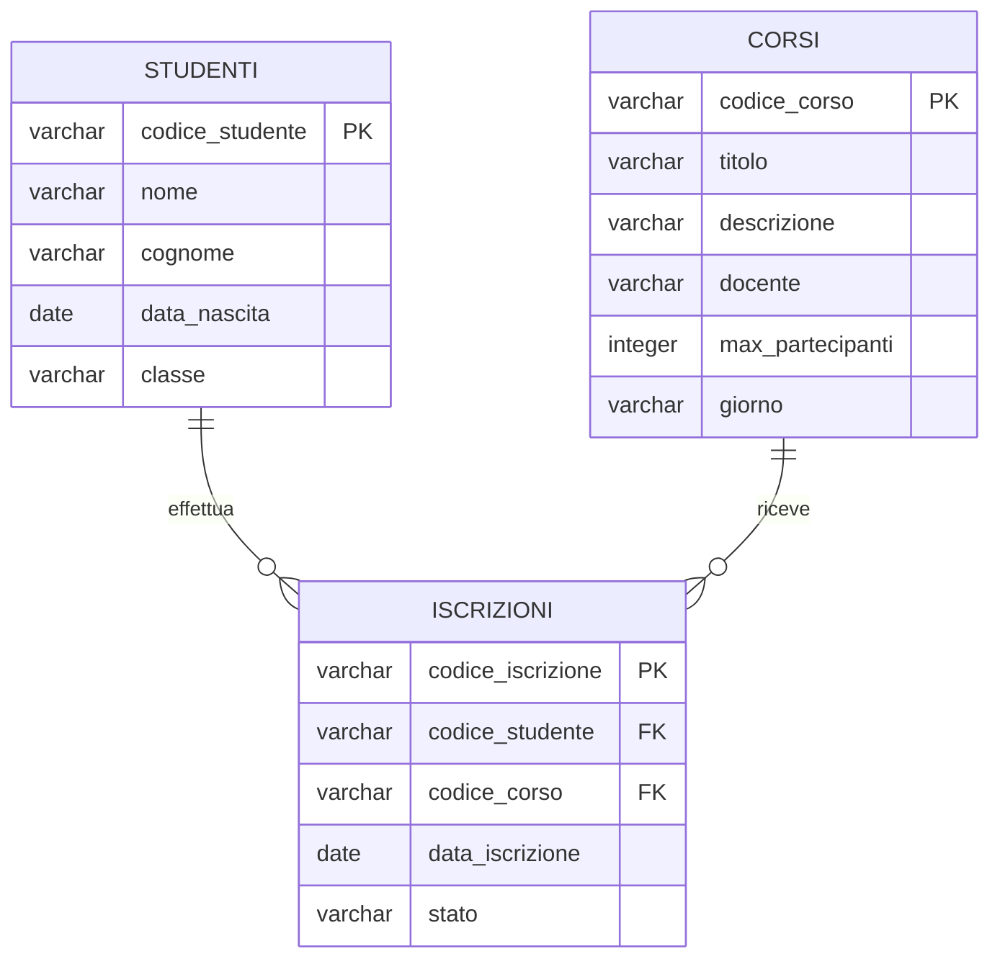

# SQL e il nostro primo database relazionale — Dispensa introduttiva

**Informatica — classe quarta | Laboratorio con DB Browser for SQLite**  
**Caso di studio:** gestione dei corsi pomeridiani  
**Percorso:** DDL → DML → QL

> **Come utilizzare questa dispensa.** Leggere il modello, creare il database vuoto e provare le istruzioni nella scheda **Esegui SQL** di DB Browser for SQLite. Per ciascuna tabella sono riportate **due definizioni alternative**: **A, essenziale**, per il primo laboratorio, e **B, rafforzata**, per studiare i controlli di integrità. **Non eseguire entrambe le definizioni sullo stesso database.** I dati e le interrogazioni successive funzionano con entrambe. Tutti gli esempi sono fittizi.

---

## 1. Introduzione al linguaggio SQL

SQL (*Structured Query Language*) è un linguaggio utilizzato per interagire con le basi di dati relazionali attraverso un sistema di gestione denominato **DBMS** (*Database Management System*).

Attraverso SQL possiamo definire la struttura di un database, inserire e modificare i dati memorizzati ed effettuare interrogazioni per ricavare le informazioni di nostro interesse.

Le istruzioni SQL vengono comunemente suddivise, a livello didattico, in diverse categorie, ciascuna destinata a uno specifico insieme di operazioni.

### 1.1 DDL — Data Definition Language

Il DDL, ovvero *linguaggio di definizione dei dati*, comprende le istruzioni che permettono di **definire e modificare la struttura di un database** e degli oggetti che lo compongono.

| Istruzione | Funzione |
|---|---|
| `CREATE` | Crea un nuovo oggetto, ad esempio una tabella |
| `ALTER` | Modifica la struttura di una tabella esistente |
| `DROP` | Elimina un oggetto dal database |

Attraverso il DDL possiamo definire le tabelle, specificare gli attributi, assegnare i tipi di dato e stabilire i vincoli di integrità, come chiavi primarie ed esterne.

**Esempio:** creare una tabella per memorizzare gli studenti di una scuola.

### 1.2 DML — Data Manipulation Language

Il DML, ovvero *linguaggio di manipolazione dei dati*, comprende le istruzioni utilizzate per **inserire, modificare ed eliminare i dati contenuti nelle tabelle**.

| Istruzione | Funzione |
|---|---|
| `INSERT INTO` | Inserisce una o più tuple in una tabella |
| `UPDATE` | Modifica i valori delle tuple esistenti |
| `DELETE FROM` | Elimina una o più tuple da una tabella |

Le istruzioni DML agiscono sui dati memorizzati, senza modificare la struttura delle tabelle.

**Esempio:** inserire un nuovo studente, modificarne la classe oppure eliminare la sua registrazione.

### 1.3 QL — Query Language

Il QL, ovvero *linguaggio di interrogazione*, comprende le istruzioni utilizzate per **consultare ed estrarre informazioni dai dati memorizzati nel database**.

| Istruzione | Funzione |
|---|---|
| `SELECT` | Seleziona ed estrae dati da una o più tabelle |

Attraverso le interrogazioni, denominate *query*, possiamo selezionare specifiche colonne, filtrare le tuple in base a determinate condizioni, ordinare i risultati e combinare dati provenienti da più tabelle.

**Esempio:** individuare tutti gli studenti iscritti a un determinato corso pomeridiano.

> **Nota terminologica.** La categoria delle interrogazioni viene spesso indicata anche come **DQL** (*Data Query Language*). In alcune classificazioni, `SELECT` è considerata parte del DML. Qui manteniamo distinti DML e QL per evidenziare la differenza fra manipolazione e interrogazione dei dati.

### 1.4 Riepilogo

| Categoria | Significato | Ambito |
|---|---|---|
| **DDL** | Definizione | Struttura |
| **DML** | Manipolazione | Dati |
| **QL** | Interrogazione | Informazioni |

---

## 2. I principali tipi di dato utilizzabili in SQL

Quando creiamo una tabella dobbiamo stabilire quali attributi la compongono e quali valori possono contenere. Un **tipo di dato** indica la natura dei valori: testo, numero, data, orario oppure dati binari.

### 2.1 Tipi di dato testuali

| Tipo | Descrizione | Esempio |
|---|---|---|
| `CHAR(n)` | Stringa di lunghezza fissa secondo la semantica SQL tradizionale | `CHAR(4)` |
| `VARCHAR(n)` | Stringa a lunghezza variabile, con un massimo dichiarato di n caratteri | `VARCHAR(50)` |
| `TEXT` | Testo a lunghezza variabile | `TEXT` |

```sql
nome VARCHAR(50)
cognome VARCHAR(50)
codice_studente VARCHAR(4)
```

Nei nostri esercizi utilizzeremo **`VARCHAR(n)` per tutti gli attributi testuali**, compresi i codici identificativi.

In SQLite la lunghezza indicata tra parentesi non viene imposta automaticamente: ad esempio, `VARCHAR(4)` può accettare anche una stringa di più di quattro caratteri.

### 2.2 Tipi di dato numerici

| Tipo | Descrizione tradizionale | Esempio |
|---|---|---|
| `INTEGER` | Numero intero | `25` |
| `NUMERIC(n)` | Numero con precisione dichiarata di n cifre | `NUMERIC(4)` |
| `NUMERIC(n,p)` | Numero con n cifre complessive, di cui p decimali | `NUMERIC(6,2)` |
| `DECIMAL(n)` | Numero decimale con precisione dichiarata di n cifre | `DECIMAL(4)` |
| `DECIMAL(n,p)` | Numero decimale con n cifre complessive, di cui p dopo la virgola | `DECIMAL(6,2)` |
| `REAL` | Numero in virgola mobile | `12.75` |
| `FLOAT` | Numero in virgola mobile | `3.14` |
| `DOUBLE` | Numero in virgola mobile, tradizionalmente a doppia precisione | `3.141592` |

**Esempio:** in un DBMS che applica rigorosamente `DECIMAL(6,2)`, il valore `1234.56` utilizza sei cifre complessive, di cui due decimali.

Per rappresentare un numero intero compreso tra 1 e 30 possiamo scrivere:

```sql
max_partecipanti INTEGER NOT NULL
    CHECK (max_partecipanti BETWEEN 1 AND 30)
```

È il vincolo `CHECK`, non il solo tipo `INTEGER`, a definire l'intervallo ammesso.

### 2.3 Tipi di dato temporali

| Tipo | Descrizione | Esempio |
|---|---|---|
| `DATE` | Data | `'2009-03-14'` |
| `TIME` | Ora | `'15:30:00'` |
| `TIMESTAMP` | Data e ora | `'2026-10-05 15:30:00'` |
| `DATETIME` | Data e ora, in DBMS che prevedono questo tipo | `'2026-10-05 15:30:00'` |

| Informazione | Formato | Esempio |
|---|---|---|
| Data | `YYYY-MM-DD` | `2009-03-14` |
| Ora | `HH:MM:SS` | `15:30:00` |
| Data e ora | `YYYY-MM-DD HH:MM:SS` | `2026-10-05 15:30:00` |

Il formato `YYYY-MM-DD` indica **anno-mese-giorno**. Ad esempio, il 14 marzo 2009 si scrive:

```sql
'2009-03-14'
```

non:

```sql
'14/03/2009'
```

Il formato anno-mese-giorno è utile in SQLite per confronti cronologici e funzioni sulle date.

### 2.4 Altri tipi di dato

| Tipo | Utilizzo | Osservazione |
|---|---|---|
| `BOOLEAN` | Valori logici veri o falsi | SQLite memorizza normalmente `1` e `0` |
| `BLOB` | Dati binari | Ad esempio immagini o file |
| `NULL` | Valore assente o sconosciuto | Non è propriamente un tipo dichiarato per una colonna |

### 2.5 Attenzione: come SQLite interpreta i tipi di dato

SQLite non gestisce i tipi esattamente come MySQL, MariaDB o PostgreSQL. Internamente distingue cinque classi di memorizzazione:

| Classe SQLite | Significato |
|---|---|
| `NULL` | Valore nullo |
| `INTEGER` | Numero intero |
| `REAL` | Numero in virgola mobile |
| `TEXT` | Stringa |
| `BLOB` | Dati binari |

SQLite accetta dichiarazioni come `VARCHAR`, `DECIMAL`, `NUMERIC`, `DATE`, `TIME` e `TIMESTAMP`, ma le associa a proprie regole di *affinità* e conversione.

- `VARCHAR(n)` non garantisce una lunghezza massima.
- `NUMERIC(n)` e `DECIMAL(n,p)` non impongono automaticamente la precisione dichiarata.
- `FLOAT` viene associato all'affinità `REAL`.
- `DATE`, `TIME` e `TIMESTAMP` non sono veri tipi temporali di memorizzazione dedicati.
- Una colonna `INTEGER` in una normale tabella SQLite può comunque accettare certi valori incompatibili con l'intenzione del progettista.

Per questo introdurremo `CHECK`, che permette di imporre controlli aggiuntivi.

---

## 3. Il caso di studio: i corsi pomeridiani

Un istituto scolastico organizza corsi pomeridiani ai quali gli studenti possono iscriversi volontariamente. Vogliamo costruire un database per registrare gli studenti, le caratteristiche dei corsi e le iscrizioni effettuate.

### 3.1 Le tabelle del database

- **STUDENTI:** `codice_studente` (**PK**), `nome`, `cognome`, `data_nascita`, `classe`.
- **CORSI:** `codice_corso` (**PK**), `titolo`, `descrizione`, `docente`, `max_partecipanti`, `giorno`.
- **ISCRIZIONI:** `codice_iscrizione` (**PK**), `codice_studente` (**FK**), `codice_corso` (**FK**), `data_iscrizione`, `stato`.

`codice_iscrizione` è una **chiave primaria artificiale** (*surrogate key*): il codice identifica la registrazione ma non rappresenta un'informazione autonoma del dominio.

### 3.2 Il modello relazionale e le molteplicità



La relazione STUDENTI–ISCRIZIONI è **1:N**: uno studente può effettuare più iscrizioni, ma ogni iscrizione appartiene a un solo studente.

La relazione CORSI–ISCRIZIONI è **1:N**: un corso può ricevere più iscrizioni, ma ogni iscrizione fa riferimento a un solo corso.

Di conseguenza, STUDENTI e CORSI sono in relazione **N:M**, realizzata attraverso la tabella associativa ISCRIZIONI. Una scuola può avere anche studenti senza iscrizioni e corsi senza studenti iscritti.

### 3.3 Esempi di tuple

Osserviamo i dati fittizi che inseriremo nelle tabelle.

**STUDENTI — 8 tuple**

| codice_studente (PK) | nome | cognome | data_nascita | classe |
|---|---|---|---|---|
| S001 | Giulia | Rossi | 2009-03-14 | 4AS |
| S002 | Marco | Bianchi | 2008-11-02 | 4AS |
| S003 | Sofia | Verdi | 2009-06-21 | 4AS |
| S004 | Luca | Neri | 2009-01-09 | 4BS |
| S005 | Emma | Gallo | 2008-09-30 | 4BS |
| S006 | Andrea | Conti | 2009-12-17 | 4AS |
| S007 | Chiara | Moretti | 2008-04-05 | 4BS |
| S008 | Davide | Romano | 2009-08-12 | 4AS |

**CORSI — 5 tuple**

| codice_corso (PK) | titolo | descrizione | docente | max_partecipanti | giorno |
|---|---|---|---|---:|---|
| C01 | Python base | Introduzione alla programmazione | Prof. Ferri | 4 | Lunedì |
| C02 | Fotografia digitale | Scatto e composizione | Prof.ssa Greco | 3 | Martedì |
| C03 | Inglese conversazione | Dialoghi in lingua inglese | Prof.ssa Riva | 4 | Mercoledì |
| C04 | Robotica educativa | Sensori e piccoli robot | Prof. Moretti | 3 | Giovedì |
| C05 | Teatro | Espressione e recitazione | Prof.ssa Costa | 2 | Venerdì |

**ISCRIZIONI — 12 tuple**

| codice_iscrizione (PK) | codice_studente (FK) | codice_corso (FK) | data_iscrizione | stato |
|---|---|---|---|---|
| I001 | S001 | C01 | 2026-10-05 | attiva |
| I002 | S001 | C02 | 2026-10-06 | attiva |
| I003 | S002 | C01 | 2026-10-05 | attiva |
| I004 | S002 | C03 | 2026-10-07 | completata |
| I005 | S003 | C03 | 2026-10-06 | attiva |
| I006 | S004 | C04 | 2026-10-08 | attiva |
| I007 | S004 | C01 | 2026-10-09 | ritirata |
| I008 | S005 | C02 | 2026-10-06 | attiva |
| I009 | S005 | C03 | 2026-10-07 | attiva |
| I010 | S006 | C01 | 2026-10-09 | attiva |
| I011 | S006 | C04 | 2026-10-10 | attiva |
| I012 | S007 | C03 | 2026-10-10 | attiva |

La prima iscrizione `I001` collega `S001` (Giulia Rossi) a `C01` (Python base), evitando di ripetere nome dello studente e titolo del corso nella tabella ISCRIZIONI.

---

## 4. DDL — Creazione delle tabelle

Passiamo alla realizzazione del database attraverso `CREATE TABLE`.

Per ogni tabella proporremo:

- **Versione A — Essenziale:** attributi, chiave primaria, chiavi esterne e `NOT NULL`.
- **Versione B — Rafforzata:** controlli `CHECK`, formati, intervalli e ulteriori vincoli di integrità.

> **Importantissimo:** A e B sono **alternative**, non due istruzioni da eseguire in sequenza sullo stesso database. Per la prima lezione utilizzare i tre `CREATE TABLE` di tipo **A**; per sperimentare i controlli, creare un secondo database vuoto e utilizzare i tre `CREATE TABLE` di tipo **B**. Per esempio, `Corsi_Pomeridiani_Base.db` e `Corsi_Pomeridiani_Vincoli.db`.

### 4.1 Preparazione di DB Browser for SQLite

1. Aprire **DB Browser for SQLite**.
2. Scegliere **Nuovo database** e salvare il file `Corsi_Pomeridiani_Base.db`.
3. Aprire **Esegui SQL**.
4. Attivare le chiavi esterne:

```sql
PRAGMA foreign_keys = ON;
```

5. Verificare l'impostazione:

```sql
PRAGMA foreign_keys;
```

Il risultato atteso è **`1`**. Se compare `0`, controllare le impostazioni della connessione; il comando non può modificarle durante una transazione già aperta.

### 4.2 Prima tabella: STUDENTI

#### Versione A — Creazione essenziale

```sql
CREATE TABLE STUDENTI (
    codice_studente VARCHAR(4) PRIMARY KEY NOT NULL,
    nome VARCHAR(50) NOT NULL,
    cognome VARCHAR(50) NOT NULL,
    data_nascita DATE NOT NULL,
    classe VARCHAR(5) NOT NULL
);
```

`CREATE TABLE STUDENTI` crea la tabella. `VARCHAR(4)` indica una lunghezza prevista di quattro caratteri; `VARCHAR(50)` una lunghezza massima prevista di cinquanta. `PRIMARY KEY` definisce la chiave primaria e `NOT NULL` richiede che il valore non sia nullo. `DATE` indica l'intenzione di memorizzare una data.

In SQLite questa definizione non impedisce automaticamente un nome vuoto né un codice più lungo di quattro caratteri.

#### Versione B — Creazione con controlli aggiuntivi

```sql
CREATE TABLE STUDENTI (
    codice_studente VARCHAR(4) PRIMARY KEY NOT NULL
        CHECK (
            codice_studente GLOB 'S[0-9][0-9][0-9]'
        ),

    nome VARCHAR(50) NOT NULL
        CHECK (
            LENGTH(TRIM(nome)) > 0
            AND LENGTH(nome) <= 50
        ),

    cognome VARCHAR(50) NOT NULL
        CHECK (
            LENGTH(TRIM(cognome)) > 0
            AND LENGTH(cognome) <= 50
        ),

    data_nascita DATE NOT NULL
        CHECK (
            data_nascita GLOB
            '[0-9][0-9][0-9][0-9]-[0-9][0-9]-[0-9][0-9]'
        ),

    classe VARCHAR(5) NOT NULL
        CHECK (
            LENGTH(TRIM(classe)) > 0
            AND LENGTH(classe) <= 5
        )
);
```

| Controllo | Funzione |
|---|---|
| `GLOB 'S[0-9][0-9][0-9]'` | Richiede un codice come `S001`: `S` e tre cifre |
| `LENGTH()` | Calcola la lunghezza di una stringa |
| `TRIM()` | Elimina spazi iniziali e finali |
| `LENGTH(TRIM(nome)) > 0` | Impedisce nomi vuoti o composti solo da spazi |
| `AND` | Richiede che siano vere entrambe le condizioni |
| `GLOB` sulla data | Controlla il formato `YYYY-MM-DD`, ma non la validità effettiva del calendario |

**Precisazione:** `GLOB` controlla i caratteri e la struttura della data, ma una data inesistente può comunque rispettare quella struttura. Per un controllo completo servono verifiche ulteriori.

### 4.3 Seconda tabella: CORSI

#### Versione A — Creazione essenziale

```sql
CREATE TABLE CORSI (
    codice_corso VARCHAR(3) PRIMARY KEY NOT NULL,
    titolo VARCHAR(80) NOT NULL,
    descrizione VARCHAR(200),
    docente VARCHAR(60) NOT NULL,
    max_partecipanti INTEGER NOT NULL,
    giorno VARCHAR(12) NOT NULL
);
```

`descrizione` è facoltativa perché non ha `NOT NULL`. `max_partecipanti` è dichiarato `INTEGER`, perché vogliamo rappresentare un numero intero. La struttura essenziale non impedisce valori negativi né giorni non previsti.

#### Versione B — Creazione con controlli aggiuntivi

```sql
CREATE TABLE CORSI (
    codice_corso VARCHAR(3) PRIMARY KEY NOT NULL
        CHECK (
            codice_corso GLOB 'C[0-9][0-9]'
        ),

    titolo VARCHAR(80) NOT NULL
        CHECK (
            LENGTH(TRIM(titolo)) > 0
            AND LENGTH(titolo) <= 80
        ),

    descrizione VARCHAR(200)
        CHECK (
            descrizione IS NULL
            OR (
                LENGTH(TRIM(descrizione)) > 0
                AND LENGTH(descrizione) <= 200
            )
        ),

    docente VARCHAR(60) NOT NULL
        CHECK (
            LENGTH(TRIM(docente)) > 0
            AND LENGTH(docente) <= 60
        ),

    max_partecipanti INTEGER NOT NULL
        CHECK (
            TYPEOF(max_partecipanti) = 'integer'
            AND max_partecipanti BETWEEN 1 AND 30
        ),

    giorno VARCHAR(12) NOT NULL
        CHECK (
            giorno IN (
                'Lunedì',
                'Martedì',
                'Mercoledì',
                'Giovedì',
                'Venerdì'
            )
        )
);
```

| Attributo | Controllo | Effetto |
|---|---|---|
| `codice_corso` | `GLOB` | Formato come C01 |
| `titolo` | `LENGTH`, `TRIM` | Non vuoto, lunghezza massima 80 |
| `descrizione` | `IS NULL`, `LENGTH`, `TRIM` | Permette `NULL`, ma controlla il testo quando presente |
| `docente` | `LENGTH`, `TRIM` | Non vuoto, max 60 |
| `max_partecipanti` | `TYPEOF`, `BETWEEN` | Numero intero tra 1 e 30 |
| `giorno` | `IN` | Uno dei cinque giorni della settimana previsti |

`BETWEEN` include gli estremi dell'intervallo. `IN` impone l'appartenenza a un elenco di valori. `TYPEOF()` è una funzione SQLite che permette di controllare il tipo effettivamente memorizzato.

### 4.4 Terza tabella: ISCRIZIONI

#### Versione A — Creazione essenziale

```sql
CREATE TABLE ISCRIZIONI (
    codice_iscrizione VARCHAR(4) PRIMARY KEY NOT NULL,
    codice_studente VARCHAR(4) NOT NULL,
    codice_corso VARCHAR(3) NOT NULL,
    data_iscrizione DATE NOT NULL,
    stato VARCHAR(12) NOT NULL,

    FOREIGN KEY (codice_studente)
        REFERENCES STUDENTI(codice_studente),

    FOREIGN KEY (codice_corso)
        REFERENCES CORSI(codice_corso)
);
```

La chiave artificiale `codice_iscrizione` identifica ogni iscrizione. Le due chiavi esterne sono `codice_studente` e `codice_corso`.

```sql
FOREIGN KEY (codice_studente)
    REFERENCES STUDENTI(codice_studente)
```

La dichiarazione stabilisce che il codice studente presente nelle iscrizioni debba riferirsi a uno studente esistente, quando i controlli referenziali sono attivi.

#### Versione B — Creazione con controlli aggiuntivi

```sql
CREATE TABLE ISCRIZIONI (
    codice_iscrizione VARCHAR(4) PRIMARY KEY NOT NULL
        CHECK (
            codice_iscrizione GLOB 'I[0-9][0-9][0-9]'
        ),

    codice_studente VARCHAR(4) NOT NULL,

    codice_corso VARCHAR(3) NOT NULL,

    data_iscrizione DATE NOT NULL
        CHECK (
            data_iscrizione GLOB
            '[0-9][0-9][0-9][0-9]-[0-9][0-9]-[0-9][0-9]'
        ),

    stato VARCHAR(12) NOT NULL
        CHECK (
            stato IN (
                'attiva',
                'ritirata',
                'completata'
            )
        ),

    FOREIGN KEY (codice_studente)
        REFERENCES STUDENTI(codice_studente)
        ON DELETE RESTRICT,

    FOREIGN KEY (codice_corso)
        REFERENCES CORSI(codice_corso)
        ON DELETE RESTRICT,

    UNIQUE (codice_studente, codice_corso)
);
```

**Controlli aggiunti:**

1. `GLOB 'I[0-9][0-9][0-9]'` richiede una chiave artificiale come `I001`.
2. `CHECK (stato IN ('attiva','ritirata','completata'))` limita gli stati ammessi.
3. `ON DELETE RESTRICT` impedisce di eliminare STUDENTI o CORSI ancora referenziati da ISCRIZIONI, con chiavi esterne attive.
4. `UNIQUE (codice_studente, codice_corso)` vieta di registrare due volte la stessa coppia studente-corso, pur consentendo a uno studente di iscriversi a più corsi.

### 4.5 Confronto tra le due versioni

| Controllo | Versione A | Versione B |
|---|---|---|
| Chiavi primarie | Sì | Sì |
| `NOT NULL` | Sì | Sì |
| Chiavi esterne | Sì | Sì |
| Stringhe vuote | Generalmente accettate | Controllate |
| Lunghezze dei testi | Non verificate | Verificate con `CHECK` |
| Formato dei codici | Non verificato | Verificato con `GLOB` |
| Intervallo della capienza | Non verificato | Da 1 a 30 |
| Stati delle iscrizioni | Non verificati | Tre valori ammessi |
| Coppia studente-corso ripetuta | Consentita | Impedita da `UNIQUE` |
| Struttura testuale delle date | Non verificata | Verificata, senza validare completamente il calendario |

### Un esperimento per la classe

Queste tre istruzioni sono **volutamente scorrette rispetto alle regole desiderate**:

```sql
-- Studente con nome vuoto
INSERT INTO STUDENTI
VALUES ('S009', '', 'Rinaldi', '2009-05-15', '4BS');

-- Corso con capienza zero
INSERT INTO CORSI
VALUES ('C06', 'Disegno digitale', 'Corso di grafica',
        'Prof.ssa Leone', 0, 'Lunedì');

-- Iscrizione con stato non previsto
INSERT INTO ISCRIZIONI
VALUES ('I013', 'S008', 'C05', '2026-10-11',
        'in_attesa');
```

**Versione A:** tutte e tre le istruzioni vengono accettate (con le chiavi esterne attive, i riferimenti di I013 esistono).  
**Versione B:** vengono rifiutate a causa dei vincoli `CHECK`.

Se i tre inserimenti sono stati eseguiti nella versione A, **ripristinare il database** eliminando le tuple di prova:

```sql
DELETE FROM ISCRIZIONI
WHERE codice_iscrizione = 'I013';

DELETE FROM CORSI
WHERE codice_corso = 'C06';

DELETE FROM STUDENTI
WHERE codice_studente = 'S009';
```

**Conclusione:** anche un'istruzione SQL sintatticamente corretta può essere rifiutata perché i dati violano i vincoli di integrità. Per la prima attività pratica utilizziamo le versioni A; le versioni B sono destinate all'approfondimento.

---
## 5. DML — Inserimento dei dati

Dopo aver creato le tabelle, possiamo popolare il database mediante `INSERT INTO`.

### 5.1 Sintassi generale

```sql
INSERT INTO Nome_Tabella
    (attributo1, attributo2, attributo3)
VALUES
    (valore1, valore2, valore3);
```

L'ordine dei valori deve corrispondere a quello degli attributi specificati. I dati testuali vanno racchiusi fra apici singoli; i numeri non richiedono apici. Useremo date nel formato `YYYY-MM-DD`.

### 5.2 Inseriamo il primo studente

```sql
INSERT INTO STUDENTI
    (codice_studente, nome, cognome, data_nascita, classe)
VALUES
    ('S001', 'Giulia', 'Rossi', '2009-03-14', '4AS');
```

L'istruzione inserisce una tupla con codice `S001`. Controlliamo:

```sql
SELECT * FROM STUDENTI;
```

`SELECT *` visualizza tutti gli attributi delle tuple presenti.

### 5.3 Inseriamo gli altri studenti

Possiamo inserire più tuple mediante un'unica istruzione `INSERT INTO`, separando i gruppi di valori con virgole.

```sql
INSERT INTO STUDENTI
    (codice_studente, nome, cognome, data_nascita, classe)
VALUES
    ('S002', 'Marco', 'Bianchi', '2008-11-02', '4AS'),
    ('S003', 'Sofia', 'Verdi', '2009-06-21', '4AS'),
    ('S004', 'Luca', 'Neri', '2009-01-09', '4BS'),
    ('S005', 'Emma', 'Gallo', '2008-09-30', '4BS'),
    ('S006', 'Andrea', 'Conti', '2009-12-17', '4AS'),
    ('S007', 'Chiara', 'Moretti', '2008-04-05', '4BS'),
    ('S008', 'Davide', 'Romano', '2009-08-12', '4AS');
```

Adesso STUDENTI contiene otto tuple.

### 5.4 Inseriamo i corsi

```sql
INSERT INTO CORSI
    (codice_corso, titolo, descrizione,
     docente, max_partecipanti, giorno)
VALUES
    ('C01', 'Python base',
     'Introduzione alla programmazione',
     'Prof. Ferri', 4, 'Lunedì'),

    ('C02', 'Fotografia digitale',
     'Scatto e composizione',
     'Prof.ssa Greco', 3, 'Martedì'),

    ('C03', 'Inglese conversazione',
     'Dialoghi in lingua inglese',
     'Prof.ssa Riva', 4, 'Mercoledì'),

    ('C04', 'Robotica educativa',
     'Sensori e piccoli robot',
     'Prof. Moretti', 3, 'Giovedì'),

    ('C05', 'Teatro',
     'Espressione e recitazione',
     'Prof.ssa Costa', 2, 'Venerdì');
```

Per `max_partecipanti` abbiamo inserito valori numerici senza apici (4, 3, 4, 3 e 2).

### 5.5 Inseriamo le iscrizioni

Prima di popolare ISCRIZIONI devono esistere STUDENTI e CORSI, poiché la tabella associativa contiene due chiavi esterne.

```sql
INSERT INTO ISCRIZIONI
    (codice_iscrizione, codice_studente,
     codice_corso, data_iscrizione, stato)
VALUES
    ('I001', 'S001', 'C01', '2026-10-05', 'attiva'),
    ('I002', 'S001', 'C02', '2026-10-06', 'attiva'),
    ('I003', 'S002', 'C01', '2026-10-05', 'attiva'),
    ('I004', 'S002', 'C03', '2026-10-07', 'completata'),
    ('I005', 'S003', 'C03', '2026-10-06', 'attiva'),
    ('I006', 'S004', 'C04', '2026-10-08', 'attiva'),
    ('I007', 'S004', 'C01', '2026-10-09', 'ritirata'),
    ('I008', 'S005', 'C02', '2026-10-06', 'attiva'),
    ('I009', 'S005', 'C03', '2026-10-07', 'attiva'),
    ('I010', 'S006', 'C01', '2026-10-09', 'attiva'),
    ('I011', 'S006', 'C04', '2026-10-10', 'attiva'),
    ('I012', 'S007', 'C03', '2026-10-10', 'attiva');
```

Ogni tupla di ISCRIZIONI contiene il proprio identificativo, i due codici di collegamento, una data e uno stato.

### 5.6 Controlliamo il popolamento

```sql
SELECT COUNT(*) FROM STUDENTI;
SELECT COUNT(*) FROM CORSI;
SELECT COUNT(*) FROM ISCRIZIONI;
```

`COUNT(*)` restituisce il numero di tuple. I risultati attesi sono:

| Tabella | Numero di tuple |
|---|---:|
| STUDENTI | **8** |
| CORSI | **5** |
| ISCRIZIONI | **12** |

---

## 6. DML — Modifica dei dati con UPDATE

`UPDATE` consente di modificare i valori già memorizzati.

### 6.1 Sintassi generale

```sql
UPDATE Nome_Tabella
SET attributo = nuovo_valore
WHERE condizione;
```

- `UPDATE` identifica la tabella.
- `SET` indica il nuovo valore di un attributo.
- `WHERE` specifica le tuple sulle quali effettuare la modifica.

### 6.2 Esempio — Modificare la classe di uno studente

Supponiamo che Davide Romano (`S008`) venga trasferito dalla 4AS alla 4BS.

```sql
UPDATE STUDENTI
SET classe = '4BS'
WHERE codice_studente = 'S008';
```

**Verifica:**

```sql
SELECT *
FROM STUDENTI
WHERE codice_studente = 'S008';
```

| codice_studente | nome | cognome | classe prima | classe dopo |
|---|---|---|---|---|
| S008 | Davide | Romano | 4AS | **4BS** |

**Ripristino:**

```sql
UPDATE STUDENTI
SET classe = '4AS'
WHERE codice_studente = 'S008';
```

### 6.3 Esempio — Modificare la capienza di un corso

Il corso di Teatro (`C05`) può accogliere cinque studenti anziché due.

```sql
UPDATE CORSI
SET max_partecipanti = 5
WHERE codice_corso = 'C05';
```

**Verifica:**

```sql
SELECT titolo, max_partecipanti
FROM CORSI
WHERE codice_corso = 'C05';
```

**Ripristino:**

```sql
UPDATE CORSI
SET max_partecipanti = 2
WHERE codice_corso = 'C05';
```

### 6.4 Esempio — Modificare lo stato di un'iscrizione

L'iscrizione `I007` di Luca Neri è ritirata. Supponiamo che lo studente riprenda la frequenza.

```sql
UPDATE ISCRIZIONI
SET stato = 'attiva'
WHERE codice_iscrizione = 'I007';
```

**Ripristino:**

```sql
UPDATE ISCRIZIONI
SET stato = 'ritirata'
WHERE codice_iscrizione = 'I007';
```

### 6.5 Perché WHERE è importante?

```sql
-- ESEMPIO DA NON ESEGUIRE
UPDATE STUDENTI
SET classe = '4AS';
```

Senza `WHERE`, la query aggiornerebbe la classe di **tutti** gli studenti.

---

## 7. DML — Eliminazione dei dati con DELETE

`DELETE FROM` permette di eliminare una o più tuple da una tabella.

### 7.1 Sintassi generale

```sql
DELETE FROM Nome_Tabella
WHERE condizione;
```

### 7.2 Esempio — Eliminare un'iscrizione

Eliminiamo l'iscrizione `I012` relativa a Chiara Moretti e Inglese conversazione.

```sql
DELETE FROM ISCRIZIONI
WHERE codice_iscrizione = 'I012';
```

**Verifica:**

```sql
SELECT *
FROM ISCRIZIONI
WHERE codice_iscrizione = 'I012';
```

Non comparirà alcuna tupla, poiché la registrazione è stata eliminata.

### 7.3 Ripristiniamo l'iscrizione

```sql
INSERT INTO ISCRIZIONI
    (codice_iscrizione, codice_studente,
     codice_corso, data_iscrizione, stato)
VALUES
    ('I012', 'S007', 'C03', '2026-10-10', 'attiva');
```

### 7.4 Attenzione alle eliminazioni

```sql
-- ESEMPIO DA NON ESEGUIRE
DELETE FROM ISCRIZIONI;
```

Senza `WHERE`, l'istruzione eliminerebbe tutte le iscrizioni presenti nella tabella.

Diversamente:

```sql
-- ESEMPIO DA NON ESEGUIRE
DROP TABLE ISCRIZIONI;
```

`DROP TABLE` elimina la struttura della tabella insieme ai dati; `DELETE FROM` elimina solo le tuple.

| Istruzione DML | Effetto |
|---|---|
| `INSERT INTO` | Aggiunge nuove tuple |
| `UPDATE` | Modifica tuple esistenti |
| `DELETE FROM` | Elimina tuple esistenti |

---

## 8. QL — Le prime interrogazioni con SELECT

L'istruzione `SELECT` permette di estrarre informazioni dalle tabelle.

### 8.1 Visualizzare tutti gli studenti

```sql
SELECT *
FROM STUDENTI;
```

L'asterisco `*` visualizza tutte le colonne.

### 8.2 Visualizzare soltanto nome e cognome

```sql
SELECT nome, cognome
FROM STUDENTI;
```

### 8.3 Selezionare gli studenti di una classe

```sql
SELECT nome, cognome, classe
FROM STUDENTI
WHERE classe = '4AS';
```

| nome | cognome | classe |
|---|---|---|
| Giulia | Rossi | 4AS |
| Marco | Bianchi | 4AS |
| Sofia | Verdi | 4AS |
| Andrea | Conti | 4AS |
| Davide | Romano | 4AS |

`WHERE` filtra le tuple secondo una condizione.

### 8.4 Gli operatori di confronto

| Operatore | Significato |
|---|---|
| `=` | Uguale |
| `<>` | Diverso |
| `>` | Maggiore |
| `<` | Minore |
| `>=` | Maggiore o uguale |
| `<=` | Minore o uguale |

Esempio: corsi con capienza almeno quattro.

```sql
SELECT titolo, max_partecipanti
FROM CORSI
WHERE max_partecipanti >= 4;
```

| titolo | max_partecipanti |
|---|---:|
| Python base | 4 |
| Inglese conversazione | 4 |

### 8.5 Ordinare i risultati con ORDER BY

```sql
SELECT nome, cognome
FROM STUDENTI
ORDER BY cognome ASC;
```

`ORDER BY` ordina i risultati. `ASC` significa crescente; `DESC` decrescente.

```sql
SELECT nome, cognome
FROM STUDENTI
ORDER BY cognome DESC;
```

### 8.6 Utilizzare le condizioni AND e OR

**Esempio con AND:** studenti 4AS nati nel 2009.

```sql
SELECT nome, cognome, classe, data_nascita
FROM STUDENTI
WHERE classe = '4AS'
  AND data_nascita BETWEEN '2009-01-01' AND '2009-12-31';
```

**Risultato:** Giulia Rossi, Sofia Verdi, Andrea Conti e Davide Romano.

**Esempio con OR:** studenti 4AS oppure studenti che si chiamano Emma.

```sql
SELECT nome, cognome, classe
FROM STUDENTI
WHERE classe = '4AS'
   OR nome = 'Emma';
```

**Risultato:** sei studenti, ossia i cinque della 4AS più Emma Gallo della 4BS.

### 8.7 Interrogare le date

SQLite mette a disposizione `strftime()` per estrarre componenti di una data.

```sql
SELECT nome, cognome, data_nascita
FROM STUDENTI
WHERE strftime('%Y', data_nascita) = '2009'
ORDER BY data_nascita;
```

`strftime('%Y', data_nascita)` restituisce l'anno della data nel formato a quattro cifre.

| nome | cognome | data_nascita |
|---|---|---|
| Luca | Neri | 2009-01-09 |
| Giulia | Rossi | 2009-03-14 |
| Sofia | Verdi | 2009-06-21 |
| Davide | Romano | 2009-08-12 |
| Andrea | Conti | 2009-12-17 |

### 8.8 Contare le tuple con COUNT

```sql
SELECT COUNT(*) AS totale_studenti
FROM STUDENTI;
```

**Risultato:** `8`. `COUNT(*)` conta le tuple e `AS` dà un nome alla colonna risultante.

```sql
SELECT COUNT(*) AS iscrizioni_attive
FROM ISCRIZIONI
WHERE stato = 'attiva';
```

**Risultato:** `10` iscrizioni attive.

---

## 9. QL — Collegare più tabelle con JOIN

Le informazioni relative a studenti, corsi e iscrizioni si trovano in tabelle distinte. Le operazioni `JOIN` permettono di combinarle sfruttando i valori delle chiavi primarie ed esterne.

### 9.1 INNER JOIN tra STUDENTI e ISCRIZIONI

Vogliamo conoscere le iscrizioni di Giulia Rossi (`S001`).

```sql
SELECT
    STUDENTI.nome,
    STUDENTI.cognome,
    ISCRIZIONI.codice_corso
FROM STUDENTI
INNER JOIN ISCRIZIONI
    ON STUDENTI.codice_studente =
       ISCRIZIONI.codice_studente
WHERE STUDENTI.codice_studente = 'S001';
```

| nome | cognome | codice_corso |
|---|---|---|
| Giulia | Rossi | C01 |
| Giulia | Rossi | C02 |

`INNER JOIN` combina soltanto le tuple che soddisfano la condizione di collegamento specificata da `ON`.

### 9.2 INNER JOIN tra tre tabelle

Per visualizzare anche il titolo dei corsi, colleghiamo la tabella CORSI.

```sql
SELECT
    s.nome,
    s.cognome,
    c.titolo
FROM STUDENTI AS s
INNER JOIN ISCRIZIONI AS i
    ON s.codice_studente = i.codice_studente
INNER JOIN CORSI AS c
    ON i.codice_corso = c.codice_corso
WHERE s.codice_studente = 'S001'
ORDER BY c.titolo;
```

| nome | cognome | titolo |
|---|---|---|
| Giulia | Rossi | Fotografia digitale |
| Giulia | Rossi | Python base |

Abbiamo utilizzato gli alias: `s` per STUDENTI, `i` per ISCRIZIONI e `c` per CORSI. La combinazione permette di ottenere un'informazione che non era memorizzata interamente in nessuna tabella.

### 9.3 Visualizzare gli iscritti attivi a un corso

```sql
SELECT
    s.nome,
    s.cognome,
    c.titolo
FROM STUDENTI AS s
INNER JOIN ISCRIZIONI AS i
    ON s.codice_studente = i.codice_studente
INNER JOIN CORSI AS c
    ON i.codice_corso = c.codice_corso
WHERE c.codice_corso = 'C01'
  AND i.stato = 'attiva'
ORDER BY s.cognome;
```

| nome | cognome | titolo |
|---|---|---|
| Marco | Bianchi | Python base |
| Andrea | Conti | Python base |
| Giulia | Rossi | Python base |

Luca Neri non compare perché la sua iscrizione è ritirata. Questa query unisce `JOIN` e una condizione `WHERE`.

---

## 10. Esercitazioni autonome

Eseguire gli esercizi nell'ordine proposto, utilizzando il database già popolato. Le soluzioni sono fornite per la verifica successiva.

### Esercizio 1 — Inserire uno studente

**Richiesta:** aggiungere `S009`, Paolo Rinaldi, nato il 15 maggio 2009, della classe 4BS.

<details><summary>Mostra la soluzione</summary>

```sql
INSERT INTO STUDENTI
    (codice_studente, nome, cognome, data_nascita, classe)
VALUES
    ('S009', 'Paolo', 'Rinaldi', '2009-05-15', '4BS');
```
</details>

### Esercizio 2 — Modificare il giorno di un corso

**Richiesta:** impostare il corso Teatro al giovedì.

<details><summary>Mostra la soluzione</summary>

```sql
UPDATE CORSI
SET giorno = 'Giovedì'
WHERE codice_corso = 'C05';
```
</details>

### Esercizio 3 — Cercare gli studenti di 4BS

**Richiesta:** visualizzare gli studenti della classe 4BS ordinati per cognome.

<details><summary>Mostra la soluzione</summary>

```sql
SELECT nome, cognome
FROM STUDENTI
WHERE classe = '4BS'
ORDER BY cognome;
```
</details>

### Esercizio 4 — Iscrizioni attive

**Richiesta:** visualizzare tutte le iscrizioni che risultano attive.

<details><summary>Mostra la soluzione</summary>

```sql
SELECT *
FROM ISCRIZIONI
WHERE stato = 'attiva';
```
</details>

### Esercizio 5 — Corsi di Emma Gallo

**Richiesta:** visualizzare nome, cognome e titolo dei corsi ai quali è iscritta Emma Gallo.

<details><summary>Mostra la soluzione</summary>

```sql
SELECT s.nome, s.cognome, c.titolo
FROM STUDENTI AS s
INNER JOIN ISCRIZIONI AS i
    ON s.codice_studente = i.codice_studente
INNER JOIN CORSI AS c
    ON i.codice_corso = c.codice_corso
WHERE s.codice_studente = 'S005';
```
</details>

### Esercizio 6 — Eliminare lo studente inserito

**Richiesta:** eliminare lo studente `S009` aggiunto nell'esercizio 1.

<details><summary>Mostra la soluzione</summary>

```sql
DELETE FROM STUDENTI
WHERE codice_studente = 'S009';
```
</details>

**Ripristino conclusivo:** reinserire il giorno originale del corso Teatro:

```sql
UPDATE CORSI
SET giorno = 'Venerdì'
WHERE codice_corso = 'C05';
```

Se gli esercizi sono stati eseguiti nell'ordine indicato, la tabella STUDENTI torna alle otto tuple iniziali; il database mantiene cinque corsi e dodici iscrizioni.

---

## 11. Riepilogo delle istruzioni SQL studiate

| Categoria | Istruzione | Funzione |
|---|---|---|
| DDL | `CREATE TABLE` | Crea una tabella |
| DDL | `PRIMARY KEY` | Definisce la chiave primaria |
| DDL | `FOREIGN KEY` | Definisce una chiave esterna |
| DDL | `NOT NULL` | Impedisce valori nulli |
| DDL | `CHECK` | Impone condizioni sui dati |
| DDL | `UNIQUE` | Impone l'unicità |
| DML | `INSERT INTO` | Inserisce tuple |
| DML | `UPDATE` | Modifica tuple |
| DML | `DELETE FROM` | Elimina tuple |
| QL | `SELECT` | Estrae informazioni |
| QL | `WHERE` | Filtra tuple |
| QL | `ORDER BY` | Ordina risultati |
| QL | `INNER JOIN` | Combina tuple di tabelle collegate |

## 12. Conclusione dell'esercitazione

Durante questa esercitazione abbiamo costruito e utilizzato una base di dati relazionale per gestire i corsi pomeridiani di un istituto scolastico.

Siamo partiti dal modello logico relazionale, individuando entità, attributi, chiavi primarie, chiavi esterne e molteplicità. Abbiamo poi tradotto il modello in istruzioni `CREATE TABLE`, osservando come i vincoli possano rafforzare la qualità dei dati.

Successivamente abbiamo utilizzato le istruzioni DML per inserire, modificare ed eliminare tuple e le istruzioni QL per interrogare il database, applicando condizioni, ordinamenti e collegamenti tra tabelle.

**La distinzione fondamentale da ricordare è che DDL, DML e QL intervengono rispettivamente sulla struttura, sui dati e sulle informazioni ricavate dal database.**

### Come utilizzare le due fasi della dispensa

**Prima fase — Sperimentazione.** Utilizzare i `CREATE TABLE` A, imparare `INSERT`, `UPDATE`, `DELETE` e le prime `SELECT`/`JOIN`.

**Seconda fase — Integrità dei dati.** Creare un altro database vuoto con i `CREATE TABLE` B, ripopolare gli stessi dati e provare alcuni inserimenti scorretti per vedere quali vincoli intervengono.

La dispensa approfondita sviluppa successivamente vincoli, aggregazioni, `GROUP BY`, `HAVING`, `LEFT JOIN` e sottoquery.
