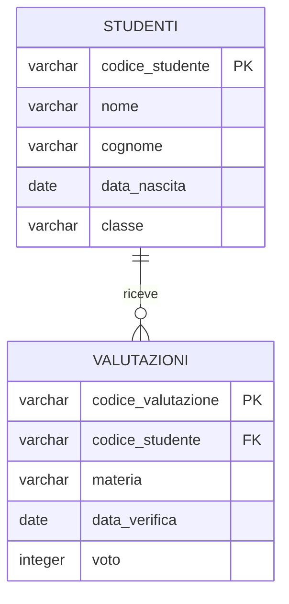

# SQL: il primo database — STUDENTI

**Informatica — classe quarta | Laboratorio con DB Browser for SQLite**  
**Percorso:** DDL → DML → QL → prima chiave esterna  
**Caso di studio:** anagrafica degli studenti di un istituto scolastico

> **Come usare la dispensa.** Cominceremo lavorando con **una sola tabella, STUDENTI**. Prima creeremo una struttura essenziale e impareremo a inserire, modificare, eliminare e interrogare le tuple. Poi vedremo una definizione alternativa della stessa tabella con controlli `CHECK` più rigorosi. **Solo alla fine** introdurremo una seconda tabella, VALUTAZIONI, per comprendere il significato delle chiavi esterne.
>
> **Attenzione:** i due `CREATE TABLE STUDENTI` (**A: essenziale** e **B: rafforzato**) sono **alternative**: non eseguirli uno dopo l'altro sullo stesso database. Per confrontarli, utilizza due file `.db` diversi.

---

## 1. Introduzione al linguaggio SQL

SQL (*Structured Query Language*) è un linguaggio utilizzato per interagire con le basi di dati relazionali attraverso un sistema di gestione denominato **DBMS** (*Database Management System*).

Attraverso SQL possiamo definire la struttura di un database, inserire e modificare i dati memorizzati ed effettuare interrogazioni per ricavare le informazioni di nostro interesse.

Le istruzioni SQL vengono comunemente suddivise a livello didattico, in diverse categorie, ciascuna destinata ad uno specifico insieme di operazioni.

### 1.1 DDL — Data Definition Language

Il DDL, ovvero *linguaggio di definizione dei dati*, comprende le istruzioni che permettono di **definire e modificare la struttura di un database**, creando, modificando o eliminando le tabelle e specificandone gli attributi, i tipi di dato ed i vincoli di integrità.

| Istruzione | Funzione |
|---|---|
| `CREATE` | Crea una nuova tabella nel database. |
| `ALTER` | Modifica la struttura di una tabella esistente |
| `DROP` | Elimina una tabella dal database |

Attraverso il DDL possiamo quindi definire le tabelle, specificare gli attributi, assegnare i tipi di dato e stabilire i vincoli di integrità, come chiavi primarie (intra-relazionale) ed esterne (inter-relazionali).

**Esempio:** creare una tabella per memorizzare gli studenti di una scuola.

### 1.2 DML — Data Manipulation Language

Il DML, ovvero *linguaggio di manipolazione dei dati*, comprende le istruzioni utilizzate per **inserire, modificare ed eliminare i dati contenuti nelle tabelle**.

| Istruzione | Funzione |
|---|---|
| `INSERT INTO` | Inserisce una o più tuple in una tabella |
| `UPDATE` | Modifica i valori delle tuple esistenti |
| `DELETE FROM` | Elimina una o più tuple da una tabella |

Le istruzioni DML agiscono sui dati memorizzati, senza modificare la struttura delle tabelle.

**Esempio:** inserire un nuovo studente, modificarne la classe oppure eliminare la sua registrazione.

### 1.3 QL — Query Language

Il QL, ovvero *linguaggio di interrogazione*, comprende le istruzioni utilizzate per **consultare ed estrarre informazioni dai dati memorizzati nel database**.

| Istruzione | Funzione |
|---|---|
| `SELECT` | Seleziona ed estrae dati da una o più tabelle |

Attraverso le interrogazioni, denominate *query*, possiamo selezionare specifiche colonne, filtrare le tuple in base a determinate condizioni, ordinare i risultati e combinare dati provenienti da più tabelle.

**Esempio:** visualizzare gli studenti di una determinata classe o nati in un particolare anno.

> **Nota terminologica.** La categoria delle interrogazioni viene spesso indicata anche come **DQL** (*Data Query Language*). 

### 1.4 Riepilogo

| Categoria | Significato | Ambito |
|---|---|---|
| **DDL** | Definizione | Struttura |
| **DML** | Manipolazione | Dati |
| **QL** | Interrogazione | Informazioni |

---

## 2. I principali tipi di dato utilizzabili in SQL

Quando creiamo una tabella dobbiamo stabilire quali attributi la compongono e quali valori possono contenere. Un **tipo di dato** indica la natura dei valori: testo, numero, data, orario oppure dati binari.

### 2.1 Tipi di dato testuali

| Tipo | Descrizione | Esempio |
|---|---|---|
| `CHAR(n)` | Stringa di lunghezza fissa secondo la semantica SQL tradizionale | `CHAR(4)` |
| `VARCHAR(n)` | Stringa a lunghezza variabile, con un massimo dichiarato di n caratteri | `VARCHAR(50)` |
| `TEXT` | Testo a lunghezza variabile | `TEXT` |

```sql
nome VARCHAR(50)
cognome VARCHAR(50)
codice_studente VARCHAR(4)
```

Nei nostri esercizi utilizzeremo **`VARCHAR(n)` per tutti gli attributi testuali**, compresi i codici identificativi.

In SQLite la lunghezza indicata tra parentesi non viene imposta automaticamente: ad esempio, `VARCHAR(4)` può accettare anche una stringa di più di quattro caratteri.

### 2.2 Tipi di dato numerici

| Tipo | Descrizione tradizionale | Esempio |
|---|---|---|
| `INTEGER` | Numero intero | `25` |
| `NUMERIC(n)` | Numero con precisione dichiarata di n cifre | `NUMERIC(4)` |
| `NUMERIC(n,p)` | Numero con n cifre complessive, di cui p decimali | `NUMERIC(6,2)` |
| `DECIMAL(n)` | Numero decimale con precisione dichiarata di n cifre | `DECIMAL(4)` |
| `DECIMAL(n,p)` | Numero decimale con n cifre complessive, di cui p dopo la virgola | `DECIMAL(6,2)` |
| `REAL` | Numero in virgola mobile | `12.75` |
| `FLOAT` | Numero in virgola mobile | `3.14` |
| `DOUBLE` | Numero in virgola mobile, tradizionalmente a doppia precisione | `3.141592` |

**Esempio:** in un DBMS che applica rigorosamente `DECIMAL(6,2)`, il valore `1234.56` utilizza sei cifre complessive, di cui due decimali.

Per rappresentare un numero intero compreso in un intervallo prestabilito, ad esempio un voto da 1 a 10, possiamo scrivere:

```sql
voto INTEGER NOT NULL
    CHECK (voto BETWEEN 1 AND 10)
```

Questo è un frammento dimostrativo, non ancora un attributo alla tabella STUDENTI. È il vincolo/condizione espressa nel `CHECK`, non il solo tipo `INTEGER`, a definire l'intervallo ammesso.

### 2.3 Tipi di dato temporali

| Tipo | Descrizione | Esempio |
|---|---|---|
| `DATE` | Data | `'2009-03-14'` |
| `TIME` | Ora | `'15:30:00'` |
| `TIMESTAMP` | Data e ora | `'2026-10-05 15:30:00'` |
| `DATETIME` | Data e ora, in DBMS che prevedono questo tipo | `'2026-10-05 15:30:00'` |

| Informazione | Formato | Esempio |
|---|---|---|
| Data | `YYYY-MM-DD` | `2009-03-14` |
| Ora | `HH:MM:SS` | `15:30:00` |
| Data e ora | `YYYY-MM-DD HH:MM:SS` | `2026-10-05 15:30:00` |

Il formato `YYYY-MM-DD` indica **anno-mese-giorno**. Ad esempio, il 14 marzo 2009 si scrive:

```sql
'2009-03-14'
```

non:

```sql
'14/03/2009'
```

Il formato anno-mese-giorno è utile in SQLite per confronti cronologici e funzioni sulle date.

### 2.4 Altri tipi di dato

| Tipo | Utilizzo | Osservazione |
|---|---|---|
| `BOOLEAN` | Valori logici veri o falsi | SQLite memorizza normalmente `1` e `0` |
| `BLOB` | Dati binari | Ad esempio immagini o file |
| `NULL` | Valore assente o sconosciuto | Non è propriamente un tipo dichiarato per una colonna |

### 2.5 Attenzione: come SQLite interpreta i tipi di dato

SQLite non gestisce i tipi esattamente come MySQL, MariaDB o PostgreSQL. Internamente distingue cinque classi di memorizzazione:

| Classe SQLite | Significato |
|---|---|
| `NULL` | Valore nullo |
| `INTEGER` | Numero intero |
| `REAL` | Numero in virgola mobile |
| `TEXT` | Stringa |
| `BLOB` | Dati binari |

SQLite accetta dichiarazioni come `VARCHAR`, `DECIMAL`, `NUMERIC`, `DATE`, `TIME` e `TIMESTAMP`, ma le associa a proprie regole di *affinità* e conversione.

- `VARCHAR(n)` non garantisce una lunghezza massima.
- `NUMERIC(n)` e `DECIMAL(n,p)` non impongono automaticamente la precisione dichiarata.
- `FLOAT` viene associato all'affinità `REAL`.
- `DATE`, `TIME` e `TIMESTAMP` non sono veri tipi temporali di memorizzazione dedicati.
- Una colonna `INTEGER` in una normale tabella SQLite può comunque accettare certi valori incompatibili con l'intenzione del progettista.

Per questo introdurremo `CHECK`, che permette di imporre controlli aggiuntivi.

---

## 3. Il nostro caso di studio: l'anagrafica degli studenti

Un istituto desidera memorizzare i dati anagrafici degli studenti. Per cominciare ci basta **una sola tabella**, chiamata STUDENTI.

### 3.1 Lo schema della tabella

**STUDENTI** (`codice_studente` **PK**, `nome`, `cognome`, `data_nascita`, `classe`)

| Attributo | Significato | Tipo che useremo |
|---|---|---|
| `codice_studente` | Codice identificativo, univoco per ogni studente | `VARCHAR(4)` |
| `nome` | Nome dello studente | `VARCHAR(50)` |
| `cognome` | Cognome dello studente | `VARCHAR(50)` |
| `data_nascita` | Data di nascita | `DATE` |
| `classe` | Classe frequentata | `VARCHAR(5)` |

La sigla **PK** significa (ovviamente) *Primary Key*, cioè **chiave primaria**; una chiave primaria identifica in maniera univoca una tupla: due studenti possono avere lo stesso nome, ma non lo stesso `codice_studente`.

Una **tupla** è una riga della tabella. Un **attributo** è una colonna. Il **grado** è il numero di attributi (qui **5**); la **cardinalità** è il numero di tuple presenti (sarà **8** dopo il popolamento).

### 3.2 Le otto tuple che inseriremo

| codice_studente (PK) | nome | cognome | data_nascita | classe |
|---|---|---|---|---|
| S001 | Giulia | Rossi | 2009-03-14 | 4AS |
| S002 | Marco | Bianchi | 2008-11-02 | 4AS |
| S003 | Sofia | Verdi | 2009-06-21 | 4AS |
| S004 | Luca | Neri | 2009-01-09 | 4BS |
| S005 | Emma | Gallo | 2008-09-30 | 4BS |
| S006 | Andrea | Conti | 2009-12-17 | 4AS |
| S007 | Chiara | Moretti | 2008-04-05 | 4BS |
| S008 | Davide | Romano | 2009-08-12 | 4AS |

**Perché un codice e non nome+cognome come chiave primaria?** Perché persone differenti possono avere lo stesso nome e cognome. Il codice permette di identificarle senza ambiguità.

---

## 4. DDL — Creazione della tabella STUDENTI

Per utilizzare concretamente il database, apri **DB Browser for SQLite**, crea un file denominato `Studenti_Base.db` e passa alla scheda **Esegui SQL**.

### 4.1 La struttura generale di CREATE TABLE

```sql
CREATE TABLE Nome_Tabella (
    attributo1 TIPO_DATO VINCOLI,
    attributo2 TIPO_DATO VINCOLI,
    attributo3 TIPO_DATO VINCOLI
);
```

Le parentesi delimitano la definizione degli attributi; la virgola separa le colonne e il punto e virgola conclude l'istruzione.

### 4.2 Versione A — La prima tabella, essenziale

**Esegui questa istruzione per iniziare il laboratorio.**

```sql
CREATE TABLE STUDENTI (
    codice_studente VARCHAR(4) PRIMARY KEY NOT NULL,
    nome VARCHAR(50) NOT NULL,
    cognome VARCHAR(50) NOT NULL,
    data_nascita DATE NOT NULL,
    classe VARCHAR(5) NOT NULL
);
```

| Elemento | Significato |
|---|---|
| `CREATE TABLE STUDENTI` | Crea la struttura della tabella STUDENTI |
| `VARCHAR(n)` | Dichiara un attributo testuale di lunghezza prevista n (non vincolante in SQLite) |
| `DATE` | Dichiara l'intenzione di memorizzare una data |
| `PRIMARY KEY` | Impedisce che due tuple abbiano lo stesso codice |
| `NOT NULL` | Impedisce di inserire `NULL` |

In SQLite una chiave primaria testuale, nelle tabelle ordinarie, non è necessariamente `NOT NULL` se non lo specifichiamo. Per questo indichiamo esplicitamente entrambi i vincoli.

### 4.3 Versione B — La stessa tabella, con controlli aggiuntivi

**Non eseguire questo `CREATE TABLE` dopo la versione A sullo stesso file `.db`.** Quando vorrai confrontare i vincoli, apri un **nuovo database vuoto**, ad esempio `Studenti_Vincoli.db`, e utilizza questa definizione al posto della precedente.

```sql
CREATE TABLE STUDENTI (
    codice_studente VARCHAR(4) PRIMARY KEY NOT NULL
        CHECK (
            codice_studente GLOB 'S[0-9][0-9][0-9]'
        ),

    nome VARCHAR(50) NOT NULL
        CHECK (
            LENGTH(TRIM(nome)) > 0
            AND LENGTH(nome) <= 50
        ),

    cognome VARCHAR(50) NOT NULL
        CHECK (
            LENGTH(TRIM(cognome)) > 0
            AND LENGTH(cognome) <= 50
        ),

    data_nascita DATE NOT NULL
        CHECK (
            data_nascita GLOB
            '[0-9][0-9][0-9][0-9]-[0-9][0-9]-[0-9][0-9]'
        ),

    classe VARCHAR(5) NOT NULL
        CHECK (
            LENGTH(TRIM(classe)) > 0
            AND LENGTH(classe) <= 5
        )
);
```

### 4.4 Perché aggiungiamo CHECK?

Il vincolo `CHECK` introduce una condizione sui valori di una colonna. In SQLite un `CHECK` viene violato quando la condizione risulta falsa. I `NOT NULL` continuano a essere necessari per rendere obbligatori i valori.

| Espressione | Significato |
|---|---|
| `LENGTH(nome)` | Restituisce la lunghezza del testo |
| `TRIM(nome)` | Elimina gli spazi iniziali e finali |
| `LENGTH(TRIM(nome)) > 0` | Impedisce nomi vuoti o composti soltanto da spazi |
| `LENGTH(nome) <= 50` | Non ammette più di 50 caratteri |
| `AND` | Richiede entrambe le condizioni |
| `codice_studente GLOB 'S[0-9][0-9][0-9]'` | Richiede una S seguita da tre cifre |
| `data_nascita GLOB '…'` | Controlla la forma `YYYY-MM-DD`, **non** la validità del calendario |

**Importante:**

- **`NOT NULL`** impedisce l'inserimento di valori nulli (`NULL`), ma non di stringhe vuote (`''`). Un valore nullo e una stringa vuota non sono la stessa cosa.
- **`CHECK (LENGTH(TRIM(nome)) > 0)`** impedisce l'inserimento di stringhe vuote o contenenti soltanto spazi, assicurando che il valore contenga almeno un carattere significativo.
- **`GLOB`** è un operatore di SQLite che permette di verificare se una stringa rispetta un determinato modello di caratteri (*pattern*). Può essere utilizzato nei vincoli `CHECK` per controllare il formato dei valori inseriti.


### 4.5 Piccolo esperimento sui vincoli

Quando avrai un database **separato** creato con la versione B, prova questi inserimenti uno alla volta:

```sql
-- PROVA ERRATA 1: il codice deve iniziare con S e avere tre cifre
INSERT INTO STUDENTI
VALUES ('ABC', 'Paolo', 'Rinaldi', '2009-05-15', '4BS');

-- PROVA ERRATA 2: il nome non può essere una stringa vuota
INSERT INTO STUDENTI
VALUES ('S009', '', 'Rinaldi', '2009-05-15', '4BS');

-- PROVA ERRATA 3: formato testuale della data sbagliato
INSERT INTO STUDENTI
VALUES ('S009', 'Paolo', 'Rinaldi', '15/05/2009', '4BS');
```

**Risultato atteso:** la versione B rifiuta tutte e tre le istruzioni per violazione del vincolo `CHECK`. La versione A le accetterebbe, salvo conflitti con chiavi già esistenti.

Per approfondire la differenza tra `NULL` e stringa vuota:

```sql
-- Violazione di NOT NULL, anche nella versione A
INSERT INTO STUDENTI
VALUES ('S009', NULL, 'Rinaldi', '2009-05-15', '4BS');
```

> Eseguire le istruzioni di prova **singolarmente** e soltanto dopo aver completato il popolamento iniziale, per non confondere gli errori attesi con quelli di preparazione del database.

---

## 5. DML — Inseriamo i dati con INSERT INTO

L'istruzione `INSERT INTO` serve ad aggiungere una nuova tupla in una tabella.

### 5.1 Sintassi generale

```sql
INSERT INTO Nome_Tabella (attributo1, attributo2)
VALUES (valore1, valore2);
```

I valori devono rispettare l'**ordine degli attributi** indicati dopo il nome della tabella. Per i testi usiamo gli **apici singoli**; per le date, il formato `YYYY-MM-DD`.

### 5.2 Primo inserimento: Giulia Rossi

```sql
INSERT INTO STUDENTI
    (codice_studente, nome, cognome, data_nascita, classe)
VALUES
    ('S001', 'Giulia', 'Rossi', '2009-03-14', '4AS');
```

Per vedere la riga appena inserita:

```sql
SELECT * FROM STUDENTI;
```

Il simbolo `*` significa **tutte le colonne**. Torneremo a studiare `SELECT` nella sezione QL.

### 5.3 Inseriamo gli altri sette studenti

```sql
INSERT INTO STUDENTI
    (codice_studente, nome, cognome, data_nascita, classe)
VALUES
    ('S002', 'Marco', 'Bianchi', '2008-11-02', '4AS'),
    ('S003', 'Sofia', 'Verdi', '2009-06-21', '4AS'),
    ('S004', 'Luca', 'Neri', '2009-01-09', '4BS'),
    ('S005', 'Emma', 'Gallo', '2008-09-30', '4BS'),
    ('S006', 'Andrea', 'Conti', '2009-12-17', '4AS'),
    ('S007', 'Chiara', 'Moretti', '2008-04-05', '4BS'),
    ('S008', 'Davide', 'Romano', '2009-08-12', '4AS');
```

Questa seconda istruzione inserisce **sette tuple contemporaneamente**: i gruppi di valori sono separati da virgole.

Per verificare il numero di tuple:

```sql
SELECT COUNT(*) AS totale_studenti
FROM STUDENTI;
```

**Risultato atteso: 8.** La funzione `COUNT(*)` conta le tuple.

---

## 6. DML — Modifichiamo i dati con UPDATE

`UPDATE` modifica i valori di tuple già presenti.

### 6.1 Sintassi generale

```sql
UPDATE Nome_Tabella
SET attributo = nuovo_valore
WHERE condizione;
```

### 6.2 Esempio: cambiare classe ad uno studente

Davide Romano (`S008`) passa temporaneamente da `4AS` a `4BS`.

```sql
UPDATE STUDENTI
SET classe = '4BS'
WHERE codice_studente = 'S008';
```

Verifichiamo:

```sql
SELECT codice_studente, nome, cognome, classe
FROM STUDENTI
WHERE codice_studente = 'S008';
```

| codice_studente | nome | cognome | classe dopo UPDATE |
|---|---|---|---|
| S008 | Davide | Romano | **4BS** |

Ripristiniamo subito la classe iniziale:

```sql
UPDATE STUDENTI
SET classe = '4AS'
WHERE codice_studente = 'S008';
```

### 6.3 Esempio: modificare più attributi

```sql
UPDATE STUDENTI
SET nome = 'Marco Antonio',
    classe = '4BS'
WHERE codice_studente = 'S002';
```

Anche qui possiamo ripristinare i dati:

```sql
UPDATE STUDENTI
SET nome = 'Marco',
    classe = '4AS'
WHERE codice_studente = 'S002';
```

### 6.4 Attenzione alla mancanza di WHERE

```sql
-- SOLO DA LEGGERE: aggiorna TUTTI gli studenti
UPDATE STUDENTI
SET classe = '4AS';
```

Senza `WHERE`, la modifica interesserebbe tutte le tuple della tabella. **Non eseguire questa istruzione** sul database che useremo per la lezione.

---

## 7. DML — Eliminiamo i dati con DELETE FROM

`DELETE FROM` permette di eliminare le tuple selezionate senza eliminare la tabella.

### 7.1 Sintassi generale

```sql
DELETE FROM Nome_Tabella
WHERE condizione;
```

### 7.2 Eliminiamo Davide Romano

Poiché non abbiamo ancora introdotto altre tabelle, possiamo eliminare lo studente `S008` senza dover considerare chiavi esterne.

```sql
DELETE FROM STUDENTI
WHERE codice_studente = 'S008';
```

Controlliamo che non sia più presente:

```sql
SELECT *
FROM STUDENTI
WHERE codice_studente = 'S008';
```

La query non restituisce righe. Per tornare agli otto studenti iniziali:

```sql
INSERT INTO STUDENTI
    (codice_studente, nome, cognome, data_nascita, classe)
VALUES
    ('S008', 'Davide', 'Romano', '2009-08-12', '4AS');
```

### 7.3 DELETE non è DROP TABLE

| Istruzione | Cosa elimina |
|---|---|
| `DELETE FROM STUDENTI WHERE ...` | Una o più tuple della tabella |
| `DROP TABLE STUDENTI` | La tabella stessa, con la sua struttura e i dati |

```sql
-- SOLO DA LEGGERE: senza WHERE cancellerebbe tutte le tuple
DELETE FROM STUDENTI;
```

**Attenzione:** l'assenza di `WHERE` può comportare l'eliminazione di tutti i record. Non eseguire l'istruzione dimostrativa.

---

## 8. QL — Le prime interrogazioni con SELECT

Una normale `SELECT` legge il contenuto del database senza modificarlo.

### 8.1 Visualizzare tutte le colonne

```sql
SELECT *
FROM STUDENTI;
```

Restituisce tutti gli attributi e tutte le tuple.

### 8.2 Visualizzare soltanto alcune colonne (PROIEZIONE)

```sql
SELECT nome, cognome
FROM STUDENTI;
```

Il risultato contiene soltanto i due attributi richiesti.

### 8.3 Usare WHERE per selezionare le tuple (SELEZIONE)

```sql
SELECT nome, cognome, classe
FROM STUDENTI
WHERE classe = '4AS';
```

**Risultato:** Giulia Rossi, Marco Bianchi, Sofia Verdi, Andrea Conti e Davide Romano (cinque studenti).

### 8.4 Gli operatori di confronto

| Operatore | Significato |
|---|---|
| `=` | Uguale |
| `<>` | Diverso |
| `>` | Maggiore |
| `<` | Minore |
| `>=` | Maggiore o uguale |
| `<=` | Minore o uguale |

**Esempio: selezionare gli studenti di classe diversa da 4AS.**

```sql
SELECT nome, cognome, classe
FROM STUDENTI
WHERE classe <> '4AS';
```

**Risultato:** Luca Neri, Emma Gallo, Chiara Moretti (tre studenti).

### 8.5 Ordinare con ORDER BY

```sql
SELECT nome, cognome
FROM STUDENTI
ORDER BY cognome ASC;
```

`ASC` significa crescente; per l'ordine inverso si usa `DESC`.

```sql
SELECT nome, cognome
FROM STUDENTI
ORDER BY cognome DESC;
```

### 8.6 Condizioni logiche AND e OR

**Studenti della 4AS nati nel 2009:**

```sql
SELECT nome, cognome, classe, data_nascita
FROM STUDENTI
WHERE classe = '4AS'
  AND data_nascita BETWEEN '2009-01-01' AND '2009-12-31';
```

**Risultato:** Giulia Rossi, Sofia Verdi, Andrea Conti e Davide Romano (quattro studenti).

**Studenti della 4AS oppure di nome Emma:**

```sql
SELECT nome, cognome, classe
FROM STUDENTI
WHERE classe = '4AS'
   OR nome = 'Emma';
```

**Risultato:** sei studenti (i cinque della 4AS più Emma Gallo).

### 8.7 Interrogare le date

SQLite mette a disposizione funzioni come `strftime()` per leggere le componenti di una data rappresentata nel formato riconosciuto `YYYY-MM-DD`.

**Studenti nati nel 2009:**

```sql
SELECT nome, cognome, data_nascita
FROM STUDENTI
WHERE strftime('%Y', data_nascita) = '2009'
ORDER BY data_nascita;
```

Risultato:

| nome | cognome | data_nascita |
|---|---|---|
| Luca | Neri | 2009-01-09 |
| Giulia | Rossi | 2009-03-14 |
| Sofia | Verdi | 2009-06-21 |
| Davide | Romano | 2009-08-12 |
| Andrea | Conti | 2009-12-17 |

Il codice di formattazione `%Y` restituisce l'anno con quattro cifre.

**Studenti nati a marzo:**

```sql
SELECT nome, cognome, data_nascita
FROM STUDENTI
WHERE strftime('%m', data_nascita) = '03';
```

**Risultato:** Giulia Rossi.

### 8.8 Cercare nei testi con LIKE

```sql
SELECT nome, cognome
FROM STUDENTI
WHERE cognome LIKE 'R%';
```

Il simbolo `%` rappresenta una sequenza qualsiasi di caratteri. La query restituisce i cognomi che iniziano con R: **Rossi** e **Romano**.

### 8.9 Eliminare le ripetizioni con DISTINCT

```sql
SELECT DISTINCT classe
FROM STUDENTI
ORDER BY classe;
```

**Risultato:** `4AS` e `4BS`, ciascuna una volta sola.

### 8.10 Contare e raggruppare

**Numero totale di studenti:**

```sql
SELECT COUNT(*) AS totale_studenti
FROM STUDENTI;
```

**Risultato:** 8.

**Numero di studenti per classe:**

```sql
SELECT classe, COUNT(*) AS numero_studenti
FROM STUDENTI
GROUP BY classe
ORDER BY classe;
```

| classe | numero_studenti |
|---|---:|
| 4AS | 5 |
| 4BS | 3 |

`GROUP BY` raccoglie le tuple con lo stesso valore di `classe`, mentre `COUNT(*)` le conta. Questo è un primo assaggio delle interrogazioni aggregate che approfondiremo in seguito.

---

## 9. Esercizi di consolidamento: una sola tabella

Prova a scrivere le query prima di leggere le soluzioni. Gli esercizi **1 e 2** modificano i dati: è indicato anche il comando di ripristino.

### Esercizio 1 — INSERT

**Consegna:** inserire Paolo Rinaldi, codice `S009`, nato il 15 maggio 2009 e appartenente alla classe `4BS`.

<details>
<summary>Mostra la soluzione</summary>

```sql
INSERT INTO STUDENTI
    (codice_studente, nome, cognome, data_nascita, classe)
VALUES
    ('S009', 'Paolo', 'Rinaldi', '2009-05-15', '4BS');
```

</details>

### Esercizio 2 — UPDATE

**Consegna:** modificare la classe di Sofia Verdi (`S003`) da `4AS` a `4BS`.

<details>
<summary>Mostra la soluzione e il ripristino</summary>

```sql
UPDATE STUDENTI
SET classe = '4BS'
WHERE codice_studente = 'S003';
```

```sql
-- Ripristino
UPDATE STUDENTI
SET classe = '4AS'
WHERE codice_studente = 'S003';
```

</details>

### Esercizio 3 — SELECT

**Consegna:** elencare nome e cognome degli studenti nati prima del 1° gennaio 2009, ordinati per data di nascita.

<details>
<summary>Mostra la soluzione</summary>

```sql
SELECT nome, cognome, data_nascita
FROM STUDENTI
WHERE data_nascita < '2009-01-01'
ORDER BY data_nascita;
```

**Risultato sul database iniziale:** Chiara Moretti, Emma Gallo, Marco Bianchi.

</details>

### Esercizio 4 — SELECT e COUNT

**Consegna:** contare gli studenti con cognome che inizia per R.

<details>
<summary>Mostra la soluzione</summary>

```sql
SELECT COUNT(*) AS cognomi_con_R
FROM STUDENTI
WHERE cognome LIKE 'R%';
```

**Risultato:** 2 (Rossi e Romano; lo studente S009, se inserito, ha cognome Rinaldi e alzerebbe il conteggio a 3).

</details>

### Esercizio 5 — DELETE e ripristino

**Consegna:** eliminare lo studente Paolo Rinaldi (`S009`) aggiunto nell'esercizio 1, ripristinando gli otto studenti iniziali.

<details>
<summary>Mostra la soluzione</summary>

```sql
DELETE FROM STUDENTI
WHERE codice_studente = 'S009';
```

**Controllo:** `SELECT COUNT(*) FROM STUDENTI;` deve restituire 8.

</details>

> Prima di proseguire, controlla che STUDENTI contenga ancora **le otto tuple iniziali**. Nella parte finale aggiungeremo una tabella collegata: partire da dati coerenti renderà più chiari gli esperimenti sulle chiavi esterne.

---

## 10. Un ultimo passo: introduciamo una chiave esterna

**Finora abbiamo utilizzato una sola tabella.** Ora introduciamo una seconda tabella soltanto per comprendere come un record possa fare riferimento a uno studente già presente in STUDENTI.

### 10.1 La nuova tabella VALUTAZIONI

Immaginiamo di voler registrare alcune valutazioni scolastiche. Per ogni valutazione memorizziamo:

- un codice identificativo della valutazione;
- lo studente al quale appartiene;
- la materia;
- la data;
- il voto.

Il modello diventa:

**STUDENTI** (`codice_studente` **PK**, `nome`, `cognome`, `data_nascita`, `classe`)  
**VALUTAZIONI** (`codice_valutazione` **PK**, `codice_studente` **FK**, `materia`, `data_verifica`, `voto`)



La molteplicità è **1:N**: uno studente può ricevere zero, una o più valutazioni (se uno studente non ha valutazioni, il suo codice_studente ovviamente non comparirà nella tabella VALUTAZIONI), mentre ogni valutazione è riferita ad uno ed un solo studente.

### 10.2 Creiamo VALUTAZIONI

La tabella STUDENTI **deve già esistere**. In DB Browser, nella connessione in cui lavoriamo, verifichiamo l'attivazione delle chiavi esterne:

```sql
PRAGMA foreign_keys;
```

Se il risultato è `0`, abilitiamo il controllo **fuori da una transazione già aperta**:

```sql
PRAGMA foreign_keys = ON;
```

Poi creiamo la nuova tabella:

```sql
CREATE TABLE VALUTAZIONI (
    codice_valutazione VARCHAR(4) PRIMARY KEY NOT NULL,
    codice_studente VARCHAR(4) NOT NULL,
    materia VARCHAR(50) NOT NULL,
    data_verifica DATE NOT NULL,
    voto INTEGER NOT NULL,

    FOREIGN KEY (codice_studente)
        REFERENCES STUDENTI(codice_studente)
);
```

**Analisi della dichiarazione fondamentale:**

```sql
FOREIGN KEY (codice_studente)
    REFERENCES STUDENTI(codice_studente)
```

- `FOREIGN KEY (codice_studente)` indica che la colonna `codice_studente` di VALUTAZIONI è una **chiave esterna**.
- `REFERENCES STUDENTI(codice_studente)` specifica a quale tabella e a quale chiave primaria si riferisce.
- Il codice inserito in VALUTAZIONI deve quindi corrispondere ad uno studente realmente presente in STUDENTI.

La colonna `codice_valutazione` è invece la **chiave primaria** della nuova tabella: identifica univocamente ogni valutazione, anche se uno studente riceve più voti.

> La definizione è volutamente essenziale: in un esercizio successivo potremmo aggiungere un `CHECK` sul voto, ma ora ci interessa soprattutto il significato della chiave esterna.

### 10.3 Inseriamo alcune valutazioni

| codice_valutazione (PK) | codice_studente (FK) | materia | data_verifica | voto |
|---|---|---|---|---|
| V001 | S001 | Informatica | 2026-10-12 | 8 |
| V002 | S001 | Matematica | 2026-10-20 | 7 |
| V003 | S002 | Informatica | 2026-10-15 | 9 |
| V004 | S004 | Informatica | 2026-10-15 | 6 |

```sql
INSERT INTO VALUTAZIONI
    (codice_valutazione, codice_studente, materia, data_verifica, voto)
VALUES
    ('V001', 'S001', 'Informatica', '2026-10-12', 8),
    ('V002', 'S001', 'Matematica', '2026-10-20', 7),
    ('V003', 'S002', 'Informatica', '2026-10-15', 9),
    ('V004', 'S004', 'Informatica', '2026-10-15', 6);
```

Osserviamo che **S001 compare due volte in VALUTAZIONI**, perché Giulia Rossi ha ricevuto due voti differenti. Il codice dello studente può ripetersi nella tabella figlia; è il **codice_valutazione** che non può duplicarsi.

### 10.4 Perché serve la chiave esterna?

Proviamo, **una sola volta**, a inserire una valutazione riferita allo studente inesistente `S999`:

```sql
-- ESEMPIO INTENZIONALMENTE ERRATO
INSERT INTO VALUTAZIONI
    (codice_valutazione, codice_studente, materia, data_verifica, voto)
VALUES
    ('V005', 'S999', 'Informatica', '2026-10-22', 8);
```

Con `PRAGMA foreign_keys = ON`, SQLite rifiuta l'inserimento con un errore di **violazione della chiave esterna**. La valutazione `V005` non viene aggiunta.

### 10.5 Il primo JOIN: dal codice al nome dello studente

Se leggiamo soltanto VALUTAZIONI vediamo i codici degli studenti, non i loro nomi. Con `JOIN` possiamo recuperare le informazioni dalle due tabelle.

```sql
SELECT
    s.nome,
    s.cognome,
    v.materia,
    v.voto
FROM STUDENTI AS s
JOIN VALUTAZIONI AS v
    ON s.codice_studente = v.codice_studente
ORDER BY s.cognome, v.materia;
```

Risultato:

| nome | cognome | materia | voto |
|---|---|---|---:|
| Marco | Bianchi | Informatica | 9 |
| Luca | Neri | Informatica | 6 |
| Giulia | Rossi | Informatica | 8 |
| Giulia | Rossi | Matematica | 7 |

- `JOIN` combina le tuple quando i codici degli studenti corrispondono.
- `ON` specifica la condizione di collegamento.
- `AS s` e `AS v` assegnano **alias** ai nomi delle tabelle (potevamo scegliere anche altro come alias, purchè non siano parole chiavi).
- `ORDER BY` ordina il risultato per cognome e materia.

**Conclusione del passaggio:** siamo passati da un database con una sola tabella ad un database con **due tabelle in relazione 1:N**. Il passo successivo, nell'esercitazione sui corsi pomeridiani, sarà costruire relazioni più articolate con una tabella associativa.

---

## 11. Riepilogo finale

| Categoria | Comando o elemento | Cosa abbiamo imparato |
|---|---|---|
| DDL | `CREATE TABLE` | Creare una tabella e definire gli attributi |
| DDL | `VARCHAR(n)`, `DATE`, `INTEGER` | Dichiarare i tipi di dato previsti |
| DDL | `PRIMARY KEY`, `NOT NULL` | Definire chiavi e valori obbligatori |
| DDL | `CHECK` | Controllare ulteriormente il contenuto dei dati |
| DML | `INSERT INTO` | Inserire una o più tuple |
| DML | `UPDATE` | Modificare tuple esistenti |
| DML | `DELETE FROM` | Eliminare tuple esistenti |
| QL | `SELECT`, `WHERE`, `ORDER BY` | Leggere, filtrare e ordinare i dati |
| QL | `COUNT`, `GROUP BY`, `LIKE`, `DISTINCT` | Primi strumenti per analizzare i dati |
| Relazioni | `FOREIGN KEY`, `REFERENCES` | Collegare VALUTAZIONI a STUDENTI |
| Relazioni | `INNER JOIN` | Leggere dati provenienti da entrambe le tabelle |

### Per continuare

Dopo questa introduzione, potremo passare alla dispensa sui **corsi pomeridiani**, nella quale lavoreremo con tre tabelle (STUDENTI, CORSI ed ISCRIZIONI) e scopriremo come realizzare una relazione **molti-a-molti (N:M)**.

**Suggerimento pratico:** salva il database di esercitazione dopo averlo popolato e dopo le operazioni di ripristino. Prima della parte sulle chiavi esterne verifica che gli studenti siano di nuovo esattamente otto.
